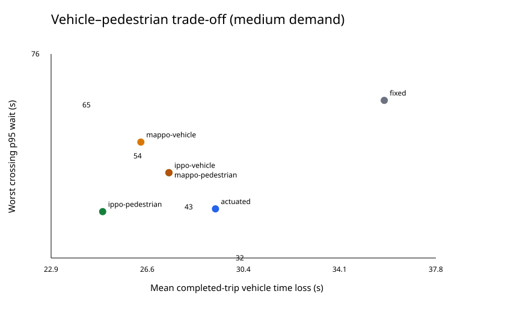

# CS4246 Team 38 — Simulation study

## Question and scope

Can local multi-agent PPO signal control improve vehicle flow without shifting excessive delay to pedestrians? This is a newly built, synthetic three-junction SUMO corridor. It is not a Singapore field validation or evidence for deployment. Pedestrian-aware RL and multi-agent signal control already exist; this study focuses on matched comparisons and per-crossing tail waits.

## Methods

- Three connected four-arm signalised junctions, each with four protected crossings and sidewalks. Vehicle flows traverse the corridor or cross a local north–south arm. Pedestrians use explicit trips. All controllers share one signal state machine: minimum vehicle green, yellow, all-red, exclusive pedestrian green, and clearance based on the longest crossing and 0.8 m/s walking speed. Occupancy extends clearance if a person remains on a crossing.
- Fixed-time and pedestrian-actuated baselines are compared with IPPO and MAPPO under vehicle-only and pedestrian-penalised rewards. Each learned actor sees its junction's queues, crossing requests and phase only. IPPO uses local value estimators; MAPPO uses a network-wide value estimator during training. The implementation uses linear policies and critics trained with clipped PPO and GAE, so its function class and training budget are limited.
- Crossing wait is the elapsed time between the first stopped crossing-approach event and entry onto the crossing edge, sampled every one second. SUMO's person `waitingTime` is only an event trigger. Immediate entry gives zero observed wait. Requests with no entry by the horizon remain unserved. Crowding before the crossing line and one-second resolution limit this measure.
- Thirty-six training episodes per learned controller use seeds 1000–1035 with three rotating demand levels. Evaluation uses the five held-out seeds 3001–3005, all nine combinations of three vehicle and three pedestrian levels, plus medium demand with 0.8 m/s pedestrians. Controllers in each paired run receive byte-identical demand. The tables give means and percentile-bootstrap 95% intervals across seeds; intervals with only five seeds are descriptive and should not be read as strong significance tests.

## Medium-demand results

Mean [95% interval] across five held-out runs. Vehicle time loss is for **completed trips** and must be read with unfinished and uninserted counts. The worst-crossing p95 is selected within each run before averaging across seeds.

| Controller | Vehicle time loss (s) | Pedestrian mean wait (s) | Worst crossing p95 (s) | Completed | Unfinished | Uninserted | Unserved requests |
|---|---:|---:|---:|---:|---:|---:|---:|
| fixed | 35.8 [34.3, 37.6] | 21.4 [19.3, 24.7] | 66.2 [63.0, 69.0] | 192.0 [192.0, 192.0] | 0.0 [0.0, 0.0] | 0.0 [0.0, 0.0] | 0.0 [0.0, 0.0] |
| actuated | 29.3 [27.4, 30.8] | 16.3 [13.7, 18.9] | 42.8 [40.8, 44.0] | 192.0 [192.0, 192.0] | 0.0 [0.0, 0.0] | 0.0 [0.0, 0.0] | 0.0 [0.0, 0.0] |
| ippo-vehicle | 27.5 [25.3, 29.5] | 18.2 [15.5, 20.9] | 50.6 [44.0, 57.2] | 192.0 [192.0, 192.0] | 0.0 [0.0, 0.0] | 0.0 [0.0, 0.0] | 0.0 [0.0, 0.0] |
| ippo-pedestrian | 24.9 [23.2, 26.9] | 16.8 [13.6, 20.2] | 42.2 [39.0, 45.2] | 192.0 [192.0, 192.0] | 0.0 [0.0, 0.0] | 0.0 [0.0, 0.0] | 0.0 [0.0, 0.0] |
| mappo-vehicle | 26.4 [25.3, 27.5] | 20.8 [19.7, 22.4] | 57.2 [54.2, 60.6] | 192.0 [192.0, 192.0] | 0.0 [0.0, 0.0] | 0.0 [0.0, 0.0] | 0.0 [0.0, 0.0] |
| mappo-pedestrian | 27.5 [25.3, 29.5] | 18.2 [15.5, 20.9] | 50.6 [44.0, 57.2] | 192.0 [192.0, 192.0] | 0.0 [0.0, 0.0] | 0.0 [0.0, 0.0] | 0.0 [0.0, 0.0] |

## Paired differences from fixed-time at medium demand

Negative vehicle time loss is a gain; positive pedestrian waiting is a cost. Every difference uses the same demand seed.

| Controller | Vehicle time loss difference (s) | Pedestrian mean-wait difference (s) | Worst crossing p95 difference (s) |
|---|---:|---:|---:|
| actuated | -6.5 [-9.1, -3.9] | -5.1 [-9.3, -0.6] | -23.4 [-25.4, -20.8] |
| ippo-vehicle | -8.3 [-10.1, -6.5] | -3.2 [-7.6, 1.2] | -15.6 [-20.6, -10.8] |
| ippo-pedestrian | -10.9 [-13.3, -8.3] | -4.6 [-9.2, 0.4] | -24.0 [-28.6, -18.8] |
| mappo-vehicle | -9.4 [-10.9, -7.9] | -0.6 [-4.2, 2.4] | -9.0 [-13.2, -5.2] |
| mappo-pedestrian | -8.3 [-10.1, -6.5] | -3.2 [-7.6, 1.2] | -15.6 [-20.6, -10.8] |

## Demand sensitivity

Each cell is mean completed-trip vehicle time loss (s) across five held-out runs. Full uncertainty and all service counts are in `summary.json` and `runs.csv`.

| Demand | fixed | actuated | ippo-vehicle | ippo-pedestrian | mappo-vehicle | mappo-pedestrian |
|---|---:|---:|---:|---:|---:|---:|
| vhigh-phigh | 40.3 | 37.0 | 33.9 | 31.1 | 33.3 | 33.8 |
| vhigh-plow | 39.6 | 31.1 | 25.6 | 24.1 | 26.9 | 25.6 |
| vhigh-pmedium | 39.7 | 35.5 | 29.9 | 27.1 | 29.1 | 29.8 |
| vlow-phigh | 33.6 | 28.0 | 26.8 | 25.2 | 26.6 | 26.8 |
| vlow-plow | 32.9 | 23.3 | 21.3 | 19.4 | 21.7 | 21.3 |
| vlow-pmedium | 33.3 | 28.0 | 25.0 | 23.5 | 24.9 | 25.0 |
| vmedium-phigh | 36.2 | 31.0 | 29.4 | 27.4 | 28.5 | 29.3 |
| vmedium-plow | 35.6 | 25.2 | 22.8 | 20.8 | 22.7 | 22.8 |
| vmedium-pmedium | 35.8 | 29.3 | 27.5 | 24.9 | 26.4 | 27.5 |

## Slower-walker check

Medium demand is rerun with pedestrian free speed reduced from 1.3 to 0.8 m/s. The clearance rule is shared by all controllers.

| Controller | Ordinary mean wait (s) | Slow mean wait (s) | Ordinary worst crossing p95 (s) | Slow worst crossing p95 (s) | Slow unserved requests (mean/run) |
|---|---:|---:|---:|---:|---:|
| fixed | 21.4 [19.3, 24.7] | 33.3 [30.2, 37.2] | 66.2 [63.0, 69.0] | 70.8 [70.4, 71.0] | 0.8 [0.0, 2.0] |
| actuated | 16.3 [13.7, 18.9] | 20.1 [17.4, 22.3] | 42.8 [40.8, 44.0] | 45.0 [45.0, 45.0] | 0.2 [0.0, 0.6] |
| ippo-vehicle | 18.2 [15.5, 20.9] | 23.0 [18.9, 26.3] | 50.6 [44.0, 57.2] | 51.8 [47.2, 56.8] | 0.4 [0.0, 0.8] |
| ippo-pedestrian | 16.8 [13.6, 20.2] | 20.6 [16.2, 23.3] | 42.2 [39.0, 45.2] | 43.4 [40.0, 45.4] | 0.2 [0.0, 0.6] |
| mappo-vehicle | 20.8 [19.7, 22.4] | 25.6 [21.0, 30.6] | 57.2 [54.2, 60.6] | 60.4 [55.2, 63.0] | 0.6 [0.2, 1.0] |
| mappo-pedestrian | 18.2 [15.5, 20.9] | 23.0 [18.9, 26.3] | 50.6 [44.0, 57.2] | 51.8 [47.2, 56.8] | 0.4 [0.0, 0.8] |

## Individual crossings

`crossing_summary.csv` reports mean wait, p95 wait, bootstrap intervals, entries and unserved requests for **every crossing under every controller and scenario**. `crossings.csv` retains every seed-level crossing result. The following table names each controller's crossing with the largest mean p95 wait at medium demand. This crossing can differ across seeds, so its mean p95 need not equal the mean of each run's worst crossing above.

| Controller | Crossing | Road edges crossed | Mean wait (s) | Mean p95 wait (s) | Entries | Unserved |
|---|---|---|---:|---:|---:|---:|
| fixed | :C2_c3 | h2w h2e | 40.3 | 57.0 | 11 | 0 |
| actuated | :C1_c3 | h1w h1e | 22.9 | 32.6 | 11 | 0 |
| ippo-vehicle | :C2_c2 | so2 si2 | 40.0 | 40.0 | 5 | 0 |
| ippo-pedestrian | :C0_c0 | no0 ni0 | 27.1 | 33.0 | 10 | 0 |
| mappo-vehicle | :C0_c1 | h1e h1w | 34.6 | 56.2 | 20 | 0 |
| mappo-pedestrian | :C2_c2 | so2 si2 | 40.0 | 40.0 | 5 | 0 |

## Interpretation and limits

Every scheduled vehicle completed in these evaluated demand levels. The accounting code still reports unfinished and uninserted trips, but this experiment does not test controllers under vehicle spillback severe enough to leave trips unserved. IPPO-vehicle and MAPPO-pedestrian have identical aggregate outcomes on 45 of 50 paired scenario-seed cases, despite different trained weights. Their labels therefore should not be read as evidence of distinct behaviour everywhere. The synthetic corridor, straight-only vehicle movements, exclusive pedestrian phase, linear policies, short training budget, small number of held-out seeds, and event sampling limit external validity. Comparisons reveal simulation trade-offs under matched demand; they do not establish a better deployed signal controller.

## Reproduce

Run `python -m unittest discover -s tests -v`, then `python -m src.traffic_control.train`, `python -m src.traffic_control.evaluate`, and `python -m src.traffic_control.report` from the repository root with SUMO and TraCI available. Configuration and seeds are in `config/`. Raw episode files are under Git-ignored `runs/`; the aggregate data and trained model weights are saved with this project.

## Team roles

Jason and Jarrell lead simulation and baselines; Shricharan and Jewi lead MARL implementation and training; Reet and Huan Kiat lead pedestrian evaluation and analysis. All team members contribute to the final report and presentation.

## References

- [SUMO pedestrian simulation](https://sumo.dlr.de/docs/Simulation/Pedestrians.html), [TraCI crossing tutorial](https://sumo.dlr.de/docs/Tutorials/TraCIPedCrossing.html), and [tripinfo output](https://sumo.dlr.de/docs/Simulation/Output/TripInfo.html).
- [The Surprising Effectiveness of PPO in Cooperative, Multi-Agent Games](https://arxiv.org/abs/2103.01955) describes centralized-value MAPPO.
- [PedSLight](https://www.frontiersin.org/journals/future-transportation/articles/10.3389/ffutr.2026.1953597/full) is an existing pedestrian- and safety-aware RL signal-control study; pedestrian-aware MARL is not claimed as a new idea here.
