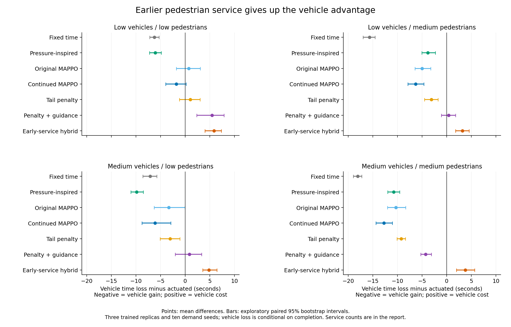
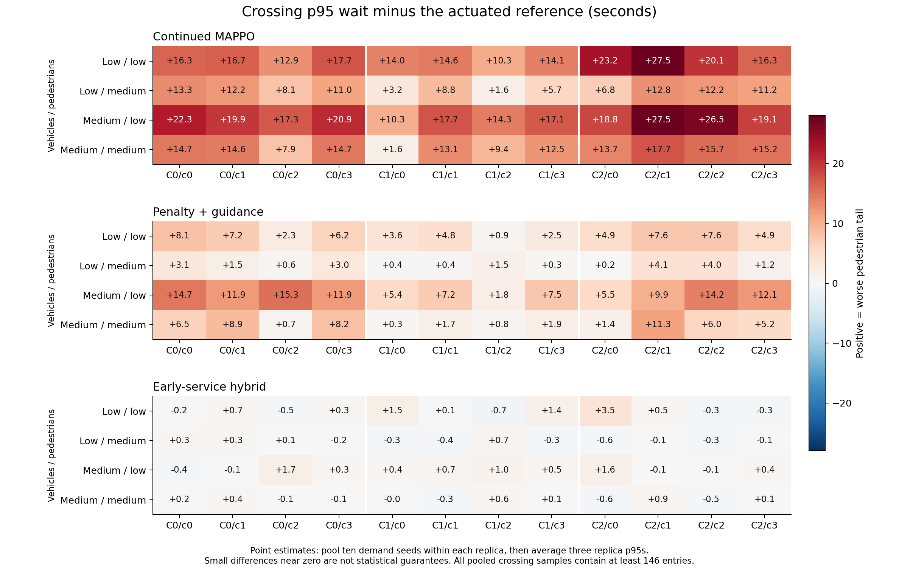
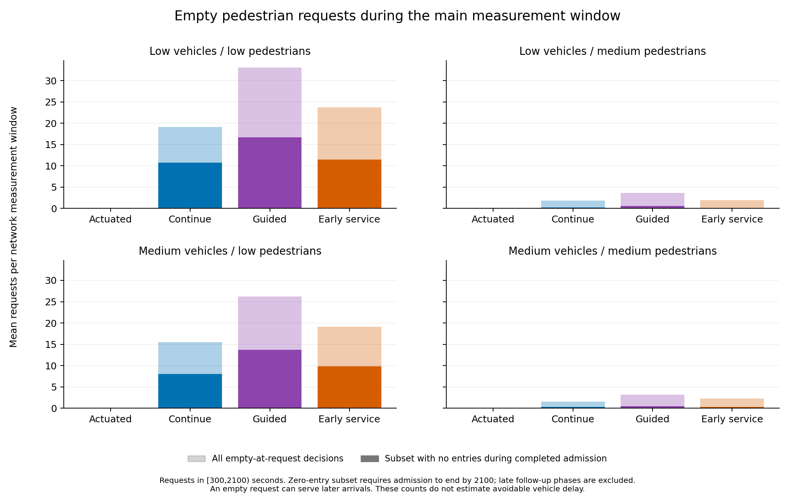

# Completed demand and early-service experiment

Reviewed 4 November 2026. **All 720 evaluations completed. Lower demand did not
produce a joint win for the saved models. Requiring earlier pedestrian service
substantially improved crossing tails relative to continued MAPPO, but increased
vehicle time loss above the pedestrian-actuated reference in every setting.**

This is a useful controlled finding about service timing and the remaining
trade-off. It does not establish that the simulator is invalid, that the goal is
impossible, or that other MARL designs cannot improve the outcome.

The study finished at 15:58 Singapore time. It evaluated existing checkpoints;
there was no new training. The four demand settings, ten new development seeds
1010001–1010010, all three training replicas, and the intervention were fixed
before the runs. Reserved final seeds 58001–58020 remain untouched.

## What was compared

Each setting contains fixed time, pedestrian-actuated and pressure-inspired
baselines, plus original, continued, tail-penalty and guided MAPPO. The additional
early-service hybrid uses exactly the continued MAPPO weights and categorical
random streams, but requests PED whenever a local crossing request is pending
and PED is legal. Otherwise its choices are unchanged, including possible
requests for pedestrian service when nobody is waiting.

All controllers use the same three-junction, 12-crossing corridor, 140 m spacing,
minimum greens, yellow/all-red transitions, 12-second pedestrian admission and
clearance protection. Teleportation is disabled in the frozen environment.
Within each setting/seed, demand and network hashes match across every controller.

| Vehicles / pedestrians | Network vehicles/hour | Network pedestrians/hour |
|---|---:|---:|
| Low / low | 960 | 400 |
| Low / medium | 960 | 1200 |
| Medium / low | 1920 | 400 |
| Medium / medium | 1920 | 1200 |

These are synthetic Poisson arrival rates, not observed Singapore counts. The
low-vehicle settings test transfer: these saved policies were not retrained for
low vehicle demand. Lowering a demand rate also changes random realizations
across settings; controllers within a setting still receive identical traffic.

## Vehicle and crossing results

Vehicle values are mean completed-trip time loss in seconds; lower is better.
Crossing counts refer to p95 point estimates no higher than the corresponding
actuated crossing. Crossing p95 pools seeds within each training replica and
then averages the three replica estimates. It is not the p95 of all replicas
pooled together, and not an average of individual-run p95s.

| Vehicles / pedestrians | Actuated | Continued MAPPO | Early-service hybrid | Hybrid vehicle change vs actuated | Hybrid crossings no worse /12 | Hybrid worst crossing excess |
|---|---:|---:|---:|---:|---:|---:|
| Low / low | 35.60 | 33.83 | 41.47 | +16.5% | 5 | +3.53 s |
| Low / medium | 45.04 | 38.74 | 48.24 | +7.1% | 8 | +0.73 s |
| Medium / low | 40.20 | 34.06 | 45.02 | +12.0% | 4 | +1.67 s |
| Medium / medium | 51.17 | 38.43 | 54.97 | +7.4% | 6 | +0.87 s |

All four ordinary learned configurations (original/continued/tail/guided) have
**0/12** crossing p95s no higher than actuated in all four settings. The hybrid's
4–8 crossing count is a partial pedestrian result accompanied by worse vehicle
time loss. **None of the five learned/hybrid configurations meets the original
joint target in any of the four settings.** Removing the strict service-count
gate would not change that conclusion.

Continued MAPPO has a vehicle gain of 24.9% at medium/medium, with a paired
95% interval for its time-loss difference of [-14.38,-11.02] seconds. Its low/low
gain is only 5.0%, and the interval [-3.97,+0.21] includes no benefit. Thus low
demand did not automatically make a strong actuated reference easier to beat.

| Vehicles / pedestrians | Hybrid minus actuated: vehicle difference, paired 95% interval | Hybrid minus continued MAPPO: vehicle difference, paired 95% interval |
|---|---|---|
| Low / low | +5.87 s [4.04,7.37] | +7.64 s [6.46,8.73] |
| Low / medium | +3.20 s [1.82,4.57] | +9.49 s [8.30,10.81] |
| Medium / low | +4.82 s [3.59,6.44] | +10.95 s [9.13,12.60] |
| Medium / medium | +3.80 s [1.98,5.68] | +16.54 s [13.92,19.04] |

The hybrid's vehicle cost is supported by these exploratory intervals. Its
pedestrian p95 point estimate improves at all 12 crossings relative to continued
MAPPO in every setting. This is a stronger intervention result than an unexplained
failed run. However, the bootstrap interval for the *largest* crossing difference
versus continued MAPPO includes zero in the two low-vehicle settings. Do not
turn the all-crossing point-estimate improvement into a universal statistical
guarantee. All intervals resample paired whole seeds and training replicas; they
are development analyses, not confirmatory simultaneous non-inferiority tests.

## Every crossing remains visible

The figure below shows all 12 crossing differences in all four settings for
continued, guided and early-service MAPPO. The [full report](archived_REPORT.md)
includes absolute p95s for every learned configuration and the actuated reference;
the [complete summary](archived_summary.json) also retains
crossing means, individual-replica p95s, entries, pointwise intervals, both other
baselines and pending requests.

Minimum pooled sample counts across model/reference replicas are 151, 469, 146
and 471 respectively for low/low, low/medium, medium/low and medium/medium. Every
crossing meets the predeclared 100-entry screening threshold. That improves
interpretability but does not remove p95 uncertainty. For example, the hybrid's
medium/medium 6/12 includes small differences near zero; only C1/c1 has an
individual pointwise interval wholly at or below zero. This does not establish
a statistically protected six-crossing subset.

## Vehicle and pedestrian service accounting

Vehicles below belong to departures scheduled in [300,2100) s, measured at
2100 s. Pedestrians reaching crossings in that interval are followed until
2400 s. Counts are means per run. A vehicle still driving at 2100 is different
from a vehicle never inserted, and a pedestrian pending at 2100 may cross during
follow-up.

| Vehicles / pedestrians | Controller | Scheduled vehicles | Completed | Unfinished | Uninserted | Crossing requests pending at 2100 | Unresolved at 2400 |
|---|---|---:|---:|---:|---:|---:|---:|
| Low / low | Actuated | 482.60 | 465.60 | 17.00 | 0.00 | 2.00 | 0 |
| Low / low | Continued | 482.60 | 468.77 | 13.83 | 0.00 | 3.13 | 0 |
| Low / low | Early service | 482.60 | 465.90 | 16.70 | 0.00 | 2.43 | 0 |
| Low / medium | Actuated | 482.60 | 467.00 | 15.60 | 0.00 | 4.10 | 0 |
| Low / medium | Continued | 482.60 | 466.03 | 16.57 | 0.00 | 5.40 | 0 |
| Low / medium | Early service | 482.60 | 464.17 | 18.43 | 0.00 | 4.73 | 0 |
| Medium / low | Actuated | 953.70 | 918.70 | 34.80 | 0.20 | 1.10 | 0 |
| Medium / low | Continued | 953.70 | 923.30 | 30.20 | 0.20 | 2.60 | 0 |
| Medium / low | Early service | 953.70 | 918.80 | 34.70 | 0.20 | 1.43 | 0 |
| Medium / medium | Actuated | 953.70 | 914.10 | 39.40 | 0.20 | 4.40 | 0 |
| Medium / medium | Continued | 953.70 | 921.27 | 32.20 | 0.23 | 7.10 | 0 |
| Medium / medium | Early service | 953.70 | 912.60 | 40.83 | 0.27 | 4.87 | 0 |

All 720 runs completed every scheduled person trip; no measured crossing request
remained unresolved after follow-up. No observed crossing entry lacked a recorded
exit. Whole-run vehicle accounting found 12 unfinished vehicles across 10 runs,
with no vehicles still uninserted at 2400. The audit lists those runs. Actuated
completed every whole-run vehicle trip; early service and continued each left
one whole-run vehicle unfinished in one medium/medium run. These finite-horizon
outcomes must remain visible, but this study does not exhibit the severe service
collapse of the earlier overloaded corridor case.

The strict paired service gate fails for early service in 24/30, 29/30, 20/30 and
26/30 runs respectively. Of those, 13, 6, 7 and 8 are **cutoff-only crossing-request
failures**, with no other service component worse. The remaining flags include
vehicle cutoff counts. None represents a measured request still waiting after
follow-up. The original target already fails on vehicle loss and crossing tails,
so interpreting cutoff flags more leniently would not produce a joint win.

Insertion delays are also retained. For medium/medium, the hybrid's mean
completed-trip insertion delay is 0.36 s versus actuated 0.32 s; adding insertion
delay does not reverse the vehicle conclusion.

## What this establishes about the failure

**Earlier service is a real lever.** The hybrid took all 16,067 recorded free
opportunities to request legal pedestrian service, versus the continued policy's
partial compliance on its own trajectories. The matched intervention changed
every crossing tail in the intended direction relative to continued MAPPO, at
a clear vehicle cost. Opportunity counts are policy-dependent, not independent
pedestrians or matched-state classification samples.

**Low load alone does not resolve the problem.** The actuated controller adapts
to reduced pedestrian demand, while saved policies still choose phases through
their learned categorical distributions. With fewer pedestrians, there is less
need for frequent crossing service. A model need not exploit that spare capacity
well merely because it performs well for vehicles at medium demand. Low-vehicle
transfer and the original 600-second training versus 2400-second evaluation
horizon remain limitations; this is not a test of retraining specifically on
low demand.

**Empty pedestrian requests are a concrete diagnostic, not a complete explanation.**
The saved policy can request PED even with no pending request. Some such phases
serve later arrivals, so it is wrong to call every empty-at-request phase wasted.
Also, phases after demand stops at 2100 cannot explain completed-trip time loss
already measured at 2100. The accompanying diagnostic separates the main window
from follow-up and counts admissions with no observed entries only when their
whole admission period lies within the measurement window.

For early service, the main measurement window contains the following averages
per network run. The zero-entry subset counts only admissions completed by 2100.

| Vehicles / pedestrians | Empty-at-request decisions | Completed admissions with no entries | Pedestrian admission + clearance: hybrid | Actuated |
|---|---:|---:|---:|---:|
| Low / low | 23.73 | 11.43 | 50.65% | 43.99% |
| Low / medium | 1.97 | 0.13 | 56.69% | 56.22% |
| Medium / low | 19.10 | 9.80 | 49.46% | 43.91% |
| Medium / medium | 2.27 | 0.27 | 56.47% | 56.38% |

This is a plausible inefficiency especially at low pedestrian demand. At medium
pedestrian demand, very few completed empty admissions have zero entries in the
measurement window, and hybrid pedestrian-service time is close to actuated.
**Empty service cannot by itself explain the whole medium-demand vehicle gap.**
Whole-run counts would exaggerate this explanation: the hybrid also requests
roughly 10–13 empty pedestrian phases per run during follow-up after the cutoff.

The [audit data](audit.json) retain whole-run, warm-up, measurement and follow-up
counts. These are descriptive mechanisms. They do not estimate how much vehicle
delay would disappear if a phase were removed; a changed schedule would change
subsequent arrivals and decisions.

**The residual crossing gap is compatible with changed signal timing.** Even
when two controllers request PED at their own first legal opportunity, their
different vehicle-phase decisions can produce different future legal-opportunity
times. The hybrid therefore need not reproduce actuated's arrival-to-entry
distribution. This explains why an early-service rule is not itself a p95
guarantee, without assuming that every small crossing difference is meaningful.

**Vehicle allocation remains a separate hypothesis.** A post-hoc read of saved
decisions found that the hybrid selected the smaller stopped vehicle queue after
clearance about 17.27 times out of 132.30 choices per medium/medium measurement
window (13.1%). Actuated selects the larger stopped queue at that decision point
by construction. Only 0.43 hybrid choices per window selected a zero stopped
queue while the other axis had queued traffic. These observations concern each
controller's own states. Choosing a smaller queue may anticipate approaching
traffic or coordination needs, so these are not automatically mistakes and do
not establish their causal delay cost. They identify a specific allocation
decision to inspect, rather than attributing all remaining cost to pedestrians.
See [vehicle-choice diagnostics](vehicle_choice_diagnostic.json).

## Concrete next hypothesis, without launching another study

If one further diagnostic is justified, test suppressing PED requests when no
pedestrian is waiting as a separate policy factor. A four-arm comparison would
be unchanged continued MAPPO, early service only, empty-request suppression only,
and both. The first two already exist in this development study. Use the same
physical safety rules and retain an ordinary actuated comparator. This could
identify whether needless phase requests contribute to the vehicle cost; it is
not a promised solution, and a benefit at low demand would still require its
own scope and uncertainty statement.

For medium pedestrian demand, the evidence instead motivates a separately
controlled test of vehicle-axis selection after clearance, or expert supervision
of those decisions. Simply reproducing actuated's choices would recover a
reference-like policy, not demonstrate a MARL advantage. This study gives no
justification for promising that either proposed change will beat the reference.

No additional simulation or training was launched during this review. The main
study and unfavorable results remain unchanged. Further training should follow
an identified decision-level improvement rather than another unchanged budget
extension or a switch to a fashionable algorithm without a testable mechanism.

## Audit and limitations

The independent review verified 55 frozen source hashes, 12 model hashes, all
720 expected run identities, all 1,440 compressed event/decision hashes, matched
demand/network identity, vehicle/person accounting and event-based waits. It
checked 449,874 crossing entries against the signal active during movement,
391,426 recorded free decisions, and 778,568 completed phase transitions for
minimum-green/yellow/all-red/admission timing and order. There were zero lost,
unknown-cohort or unresolved measured requests. Physical conflict and occupancy
clearance checks remain those of the unchanged runtime implementation; this
saved-trace audit is not a universal safety proof or fresh SUMO replay.

All 32 aggregate rows, 96 paired point/service comparisons and 56 vehicle
bootstrap intervals were independently reproduced. Crossing intervals were
inspected in the frozen reporting implementation and retained; they were not
independently regenerated in this review. The new review scripts do not import
or alter the trained models or execute archived code.

The conclusions concern one synthetic geometry, normal walkers, four selected
demand conditions, three trained replicas and ten development seeds. Keep the
previous slow-walker and overload experiments in the report. There is no claim
of deployed improvement, impossibility of MARL, or a new IPPO-versus-MAPPO ranking.

Evidence: [frozen full report](archived_REPORT.md),
[full summary](archived_summary.json), [independent audit](audit.json),
[frozen protocol](archived_protocol.json).
