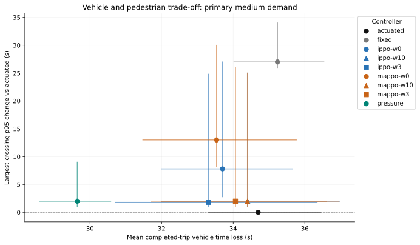
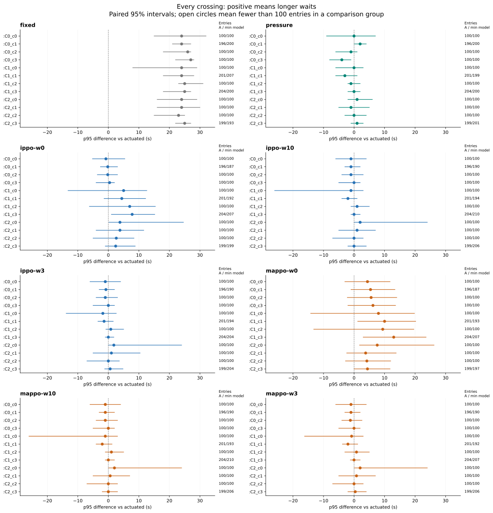
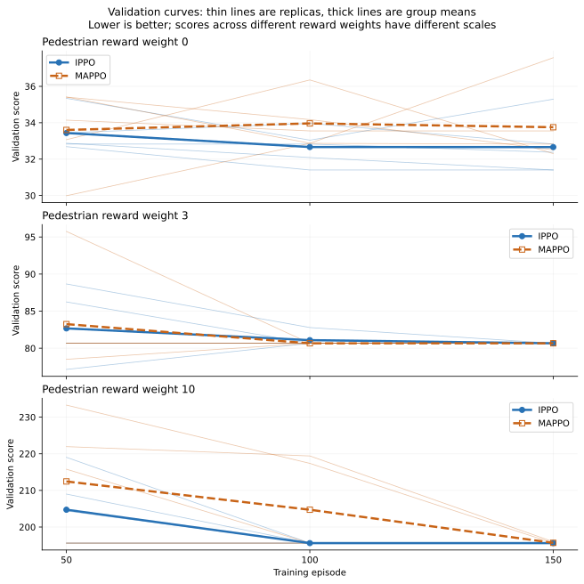

# CS4246 Team 38 — Pedestrian-aware traffic signal simulation

**Study status:** Full prespecified evaluation.

## Question

When, if ever, does multi-agent PPO save vehicle time without worsening long waits at any crossing, compared with a pedestrian-actuated controller? These are SUMO simulation findings, not proven gains for deployed signals.

## Design and measurement

- Protocol: 5 independent training initialisations per IPPO/MAPPO reward weight 0, 3 and 10, evaluated on ten locked seeds. This output contains 30 trained model replicas and 10 demand seed(s). Only validation seeds select checkpoints.
- Validation-only extension gate selected 150 episodes for every model; full comparisons are in `extension_decision.json`.
- IPPO and MAPPO use identical per-junction rewards at a given weight. Both actors see only local observations; each IPPO value estimator sees local observations, while each MAPPO value estimator may see all junction observations during training.
- All methods share the same crossing clearance, legal phases, minimum greens and yellow transitions. The pressure-inspired baseline is a queue-responsive comparator, not a direct reproduction of published max-pressure control.
- The initial 80-person burst triggered a live pedestrian-on-crossing safety failure. Its 7001–7010 groups are excluded. The revised common three-empty-step clearance and 20-person burst passed 330 development controller runs. A partial 8001–8010 run was stopped to retrain all policies under that same rule before final seeds 9001–9010; see [safety audit](../../docs/safety_revision_v3.md).
- A pedestrian request starts at the observed crossing approach and ends on crossing-edge entry. A request without entry at the horizon is unserved. Vehicle time loss describes completed trips; scheduled, completed, unfinished and uninserted trips appear together.
- Intervals resample independent training runs and matched demand seeds. Crossing p95 is calculated from pooled event waits within each training replica, then averaged across replicas. The crossing test uses a paired bootstrap of the maximum crossing-level difference.

### Learning formulation

Each junction has its own linear Bernoulli actor. Its nine local inputs are EW and NS halted-vehicle queues divided by 10, pending pedestrian requests divided by 5, phase age divided by 30, and five phase indicators. The action is hold or request an early change, eligible only during vehicle green after the minimum duration. The shared phase machine retains the phase sequence, maximum green and all transitions.

The per-second local reward is `-(qEW + qNS + w*p)/10`, where `p` is the pending request count and `w` is 0, 3 or 10. Its time integral penalises observed pedestrian waiting. IPPO has a 9-feature local linear critic per junction; MAPPO has a 27-feature network critic per junction. Both methods use the same local reward. PPO uses clip 0.2, discount 0.99, GAE lambda 0.95, four epochs, actor/critic step sizes 0.02/0.04 and entropy coefficient 0.005. Evaluation chooses action 1 when its probability is at least 0.5. This limited linear policy class is an implementation choice, not a new PPO algorithm.

### Measurement sampling check

Two trackers observed the same SUMO trajectory at 0.1-second and one-second intervals. Across 30 matched crossing entries, the one-second tracker had a mean absolute wait difference of 0.49 s and a maximum absolute difference of 1.30 s. The queued-approach rule backdates the first stopped interval, so the wait difference can exceed one second. The coarse tracker imputed 1 direct-entry wait(s) to zero; the fine tracker imputed 0. They retained 2 and 2 pending requests respectively.

| Hand-check case | Person / crossing | Fine arrival → entry (s) | Fine wait (s) | One-second wait (s) |
|---|---|---:|---:|---:|
| immediate_entry | p002 / :C0_c1 | 147.1 → 148.0 | 0.9 | 0.0 |
| pending_at_horizon | p000 / :C0_c0 | 156.0 → NA | NA | NA |
| queued_wait | p001 / :C0_c1 | 110.4 → 143.1 | 32.7 | 33.0 |

One development trajectory; 0.1-second operational events are a finer reference, not physical ground truth. This isolates observation downsampling, not SUMO step-length effects on dynamics or the 1.2 m entrance definition.

Inspect `sampling_hand_trace.csv`, `sampling_events.csv` and `sampling_audit.json` for the positions, events and source hashes. The fixture was repeated and reproduced its demand and metrics.

## Primary scenario

Scenario: **vmedium-pmedium**. Mean [95% bootstrap interval] across demand and training seeds. A low vehicle loss alongside unserved traffic is not a successful outcome.

| Controller | Vehicle time loss (s) | Pedestrian mean wait (s) | Completed | Unfinished | Uninserted | Unserved requests |
|---|---:|---:|---:|---:|---:|---:|
| fixed | 35.2 [34.0, 36.5] | 24.6 [23.5, 25.5] | 192.0 [192.0, 192.0] | 0.0 [0.0, 0.0] | 0.0 [0.0, 0.0] | 0.0 [0.0, 0.0] |
| actuated | 34.7 [33.3, 36.4] | 16.2 [15.7, 16.7] | 192.0 [192.0, 192.0] | 0.0 [0.0, 0.0] | 0.0 [0.0, 0.0] | 0.0 [0.0, 0.0] |
| pressure | 29.6 [28.6, 30.6] | 15.9 [15.2, 16.6] | 192.0 [192.0, 192.0] | 0.0 [0.0, 0.0] | 0.0 [0.0, 0.0] | 0.0 [0.0, 0.0] |
| ippo-w0 | 33.7 [32.0, 35.7] | 17.6 [16.3, 19.2] | 192.0 [192.0, 192.0] | 0.0 [0.0, 0.0] | 0.0 [0.0, 0.0] | 0.0 [0.0, 0.0] |
| ippo-w10 | 34.4 [32.0, 37.0] | 16.4 [15.7, 17.0] | 192.0 [192.0, 192.0] | 0.0 [0.0, 0.0] | 0.0 [0.0, 0.0] | 0.0 [0.0, 0.0] |
| ippo-w3 | 33.3 [30.7, 36.3] | 16.5 [15.9, 17.0] | 192.0 [192.0, 192.0] | 0.0 [0.0, 0.0] | 0.0 [0.0, 0.0] | 0.0 [0.0, 0.0] |
| mappo-w0 | 33.5 [31.5, 35.8] | 19.2 [17.7, 20.8] | 192.0 [192.0, 192.0] | 0.0 [0.0, 0.0] | 0.0 [0.0, 0.0] | 0.0 [0.0, 0.0] |
| mappo-w10 | 34.4 [32.0, 37.0] | 16.4 [15.7, 17.0] | 192.0 [192.0, 192.0] | 0.0 [0.0, 0.0] | 0.0 [0.0, 0.0] | 0.0 [0.0, 0.0] |
| mappo-w3 | 34.1 [31.7, 36.6] | 16.4 [15.7, 17.0] | 192.0 [192.0, 192.0] | 0.0 [0.0, 0.0] | 0.0 [0.0, 0.0] | 0.0 [0.0, 0.0] |

## Strict crossing-level criterion

Each controller is compared with pedestrian-actuated control on matched demand. A descriptive pass requires lower mean vehicle time loss, no higher p95 at **every crossing**, and no worse completed, unfinished, uninserted or total unserved counts, with no increase in pending requests at any crossing. Statistical support for the vehicle and tail components additionally requires the paired vehicle interval to be below zero, the simultaneous max-crossing interval to be at or below zero, and at least 100 entries per crossing in each training replica and the baseline. Service constraints are checked descriptively.

| Controller | Vehicle loss difference (s) | Largest crossing p95 difference (s) | Crossings with higher p95 | Crossings with more pending | Descriptive pass | Statistical support |
|---|---:|---:|---:|---:|---|---|
| fixed | 0.5 [-1.8, 2.8] | 27.0 [26.0, 34.0] | 12 | 0 | no | no |
| pressure | -5.1 [-6.9, -3.5] | 2.0 [1.0, 9.0] | 3 | 0 | no | no |
| ippo-w0 | -1.0 [-2.8, 1.2] | 7.8 [2.8, 27.0] | 9 | 0 | no | no |
| ippo-w10 | -0.3 [-2.4, 2.2] | 2.0 [1.0, 25.0] | 3 | 0 | no | no |
| ippo-w3 | -1.4 [-4.2, 1.5] | 1.8 [1.0, 24.8] | 4 | 0 | no | no |
| mappo-w0 | -1.2 [-3.4, 1.3] | 13.0 [8.2, 30.0] | 12 | 0 | no | no |
| mappo-w10 | -0.3 [-2.4, 2.2] | 2.0 [1.0, 25.0] | 3 | 0 | no | no |
| mappo-w3 | -0.6 [-2.7, 1.9] | 2.0 [1.0, 26.0] | 4 | 0 | no | no |

### Every crossing in the primary scenario

Positive differences mean longer pedestrian waits than the actuated baseline. The table retains low-count crossings rather than treating uncertain tails as successes.

Per-crossing mean waits use entered events; pending requests are shown separately and are excluded from wait percentiles.

| Controller | Crossing | Actuated mean / p95 (s) | Controller mean / p95 (s) | P95 difference [95% interval] (s) | Actuated / min model entries | Actuated / model pending |
|---|---|---:|---:|---:|---:|---:|
| fixed | :C0_c0 | 19.6 / 43.0 | 27.8 / 67.0 | 24.0 [15.0, 32.0] | 100 / 100 | 0 / 0.0 |
| fixed | :C0_c1 | 20.3 / 43.0 | 28.6 / 67.0 | 24.0 [21.0, 27.0] | 196 / 200 | 0 / 0.0 |
| fixed | :C0_c2 | 8.7 / 44.0 | 12.5 / 70.0 | 26.0 [18.0, 27.0] | 100 / 100 | 0 / 0.0 |
| fixed | :C0_c3 | 21.1 / 43.0 | 31.1 / 70.0 | 27.0 [22.0, 28.0] | 100 / 100 | 0 / 0.0 |
| fixed | :C1_c0 | 8.7 / 44.0 | 10.2 / 68.0 | 24.0 [8.0, 29.0] | 100 / 100 | 0 / 0.0 |
| fixed | :C1_c1 | 19.7 / 45.0 | 28.0 / 69.0 | 24.0 [18.0, 28.0] | 201 / 207 | 0 / 0.0 |
| fixed | :C1_c2 | 8.6 / 44.0 | 12.9 / 69.0 | 25.0 [23.0, 31.0] | 100 / 100 | 0 / 0.0 |
| fixed | :C1_c3 | 18.6 / 43.0 | 30.1 / 68.0 | 25.0 [18.0, 27.0] | 204 / 200 | 0 / 0.0 |
| fixed | :C2_c0 | 6.5 / 41.0 | 12.5 / 65.0 | 24.0 [16.0, 29.0] | 100 / 100 | 0 / 0.0 |
| fixed | :C2_c1 | 17.8 / 43.0 | 29.9 / 67.0 | 24.0 [16.0, 30.0] | 100 / 100 | 0 / 0.0 |
| fixed | :C2_c2 | 17.9 / 42.0 | 29.5 / 65.0 | 23.0 [15.0, 25.0] | 100 / 100 | 0 / 0.0 |
| fixed | :C2_c3 | 16.8 / 43.0 | 26.8 / 68.0 | 25.0 [22.0, 27.0] | 199 / 193 | 0 / 0.0 |
| pressure | :C0_c0 | 19.6 / 43.0 | 15.2 / 43.0 | 0.0 [-9.0, 7.0] | 100 / 100 | 0 / 0.0 |
| pressure | :C0_c1 | 20.3 / 43.0 | 20.2 / 45.0 | 2.0 [0.0, 4.0] | 196 / 200 | 0 / 0.0 |
| pressure | :C0_c2 | 8.7 / 44.0 | 6.9 / 43.0 | -1.0 [-6.0, 1.0] | 100 / 100 | 0 / 0.0 |
| pressure | :C0_c3 | 21.1 / 43.0 | 17.6 / 39.0 | -4.0 [-8.0, -1.0] | 100 / 100 | 0 / 0.0 |
| pressure | :C1_c0 | 8.7 / 44.0 | 8.0 / 44.0 | 0.0 [-6.0, 3.0] | 100 / 100 | 0 / 0.0 |
| pressure | :C1_c1 | 19.7 / 45.0 | 18.3 / 42.0 | -3.0 [-6.0, 1.0] | 201 / 199 | 0 / 0.0 |
| pressure | :C1_c2 | 8.6 / 44.0 | 9.8 / 43.0 | -1.0 [-2.0, 2.0] | 100 / 100 | 0 / 0.0 |
| pressure | :C1_c3 | 18.6 / 43.0 | 19.5 / 43.0 | 0.0 [-2.0, 2.0] | 204 / 200 | 0 / 0.0 |
| pressure | :C2_c0 | 6.5 / 41.0 | 10.0 / 42.0 | 1.0 [-2.0, 6.0] | 100 / 100 | 0 / 0.0 |
| pressure | :C2_c1 | 17.8 / 43.0 | 16.8 / 42.0 | -1.0 [-5.0, 5.0] | 100 / 100 | 0 / 0.0 |
| pressure | :C2_c2 | 17.9 / 42.0 | 16.8 / 42.0 | 0.0 [-3.0, 4.0] | 100 / 100 | 0 / 0.0 |
| pressure | :C2_c3 | 16.8 / 43.0 | 18.4 / 44.0 | 1.0 [-1.0, 3.0] | 199 / 201 | 0 / 0.0 |
| ippo-w0 | :C0_c0 | 19.6 / 43.0 | 19.5 / 42.2 | -0.8 [-5.2, 5.4] | 100 / 100 | 0 / 0.0 |
| ippo-w0 | :C0_c1 | 20.3 / 43.0 | 20.1 / 42.8 | -0.2 [-2.6, 3.0] | 196 / 187 | 0 / 0.0 |
| ippo-w0 | :C0_c2 | 8.7 / 44.0 | 8.4 / 43.8 | -0.2 [-3.6, 3.0] | 100 / 100 | 0 / 0.0 |
| ippo-w0 | :C0_c3 | 21.1 / 43.0 | 19.6 / 43.4 | 0.4 [-4.0, 2.0] | 100 / 100 | 0 / 0.0 |
| ippo-w0 | :C1_c0 | 8.7 / 44.0 | 7.3 / 49.0 | 5.0 [-13.2, 12.6] | 100 / 100 | 0 / 0.0 |
| ippo-w0 | :C1_c1 | 19.7 / 45.0 | 22.2 / 49.4 | 4.4 [-1.4, 12.2] | 201 / 192 | 0 / 0.0 |
| ippo-w0 | :C1_c2 | 8.6 / 44.0 | 8.7 / 51.0 | 7.0 [-6.2, 15.4] | 100 / 100 | 0 / 0.0 |
| ippo-w0 | :C1_c3 | 18.6 / 43.0 | 21.5 / 50.8 | 7.8 [1.0, 15.2] | 204 / 207 | 0 / 0.0 |
| ippo-w0 | :C2_c0 | 6.5 / 41.0 | 8.6 / 44.8 | 3.8 [0.2, 24.6] | 100 / 100 | 0 / 0.0 |
| ippo-w0 | :C2_c1 | 17.8 / 43.0 | 21.0 / 46.8 | 3.8 [-4.0, 11.6] | 100 / 100 | 0 / 0.0 |
| ippo-w0 | :C2_c2 | 17.9 / 42.0 | 19.7 / 44.6 | 2.6 [-5.0, 8.4] | 100 / 100 | 0 / 0.0 |
| ippo-w0 | :C2_c3 | 16.8 / 43.0 | 20.9 / 45.4 | 2.4 [-1.0, 8.8] | 199 / 199 | 0 / 0.0 |
| ippo-w10 | :C0_c0 | 19.6 / 43.0 | 19.3 / 42.0 | -1.0 [-6.0, 4.0] | 100 / 100 | 0 / 0.0 |
| ippo-w10 | :C0_c1 | 20.3 / 43.0 | 19.7 / 42.0 | -1.0 [-3.0, 2.0] | 196 / 190 | 0 / 0.0 |
| ippo-w10 | :C0_c2 | 8.7 / 44.0 | 8.2 / 43.0 | -1.0 [-4.0, 3.0] | 100 / 100 | 0 / 0.0 |
| ippo-w10 | :C0_c3 | 21.1 / 43.0 | 19.1 / 43.0 | 0.0 [-5.0, 2.0] | 100 / 100 | 0 / 0.0 |
| ippo-w10 | :C1_c0 | 8.7 / 44.0 | 7.6 / 43.0 | -1.0 [-26.0, 3.0] | 100 / 100 | 0 / 0.0 |
| ippo-w10 | :C1_c1 | 19.7 / 45.0 | 18.1 / 43.0 | -2.0 [-4.0, 1.0] | 201 / 194 | 0 / 0.0 |
| ippo-w10 | :C1_c2 | 8.6 / 44.0 | 9.3 / 45.0 | 1.0 [-1.0, 5.0] | 100 / 100 | 0 / 0.0 |
| ippo-w10 | :C1_c3 | 18.6 / 43.0 | 17.9 / 43.0 | 0.0 [-1.0, 2.0] | 204 / 210 | 0 / 0.0 |
| ippo-w10 | :C2_c0 | 6.5 / 41.0 | 8.8 / 43.0 | 2.0 [0.0, 24.0] | 100 / 100 | 0 / 0.0 |
| ippo-w10 | :C2_c1 | 17.8 / 43.0 | 19.8 / 44.0 | 1.0 [-5.0, 7.0] | 100 / 100 | 0 / 0.0 |
| ippo-w10 | :C2_c2 | 17.9 / 42.0 | 18.8 / 42.0 | 0.0 [-7.0, 3.0] | 100 / 100 | 0 / 0.0 |
| ippo-w10 | :C2_c3 | 16.8 / 43.0 | 19.9 / 43.0 | 0.0 [-2.0, 4.0] | 199 / 206 | 0 / 0.0 |
| ippo-w3 | :C0_c0 | 19.6 / 43.0 | 19.3 / 42.0 | -1.0 [-6.0, 4.0] | 100 / 100 | 0 / 0.0 |
| ippo-w3 | :C0_c1 | 20.3 / 43.0 | 19.7 / 42.2 | -0.8 [-3.0, 2.0] | 196 / 190 | 0 / 0.0 |
| ippo-w3 | :C0_c2 | 8.7 / 44.0 | 8.1 / 43.0 | -1.0 [-4.0, 3.0] | 100 / 100 | 0 / 0.0 |
| ippo-w3 | :C0_c3 | 21.1 / 43.0 | 19.1 / 43.0 | 0.0 [-5.0, 2.0] | 100 / 100 | 0 / 0.0 |
| ippo-w3 | :C1_c0 | 8.7 / 44.0 | 7.2 / 42.2 | -1.8 [-13.8, 2.6] | 100 / 100 | 0 / 0.0 |
| ippo-w3 | :C1_c1 | 19.7 / 45.0 | 18.9 / 43.6 | -1.4 [-3.4, 1.6] | 201 / 194 | 0 / 0.0 |
| ippo-w3 | :C1_c2 | 8.6 / 44.0 | 9.0 / 44.8 | 0.8 [-0.8, 5.0] | 100 / 100 | 0 / 0.0 |
| ippo-w3 | :C1_c3 | 18.6 / 43.0 | 18.7 / 43.0 | 0.0 [-1.0, 1.8] | 204 / 204 | 0 / 0.0 |
| ippo-w3 | :C2_c0 | 6.5 / 41.0 | 8.2 / 42.8 | 1.8 [0.0, 24.0] | 100 / 100 | 0 / 0.0 |
| ippo-w3 | :C2_c1 | 17.8 / 43.0 | 19.8 / 44.0 | 1.0 [-5.0, 10.4] | 100 / 100 | 0 / 0.0 |
| ippo-w3 | :C2_c2 | 17.9 / 42.0 | 18.9 / 42.0 | 0.0 [-7.0, 3.6] | 100 / 100 | 0 / 0.0 |
| ippo-w3 | :C2_c3 | 16.8 / 43.0 | 20.0 / 43.6 | 0.6 [-1.2, 4.8] | 199 / 204 | 0 / 0.0 |
| mappo-w0 | :C0_c0 | 19.6 / 43.0 | 21.0 / 47.4 | 4.4 [-3.0, 11.8] | 100 / 100 | 0 / 0.0 |
| mappo-w0 | :C0_c1 | 20.3 / 43.0 | 22.2 / 48.4 | 5.4 [-1.0, 13.4] | 196 / 187 | 0 / 0.0 |
| mappo-w0 | :C0_c2 | 8.7 / 44.0 | 9.2 / 49.6 | 5.6 [-2.2, 14.0] | 100 / 100 | 0 / 0.0 |
| mappo-w0 | :C0_c3 | 21.1 / 43.0 | 22.0 / 49.2 | 6.2 [-2.0, 13.6] | 100 / 100 | 0 / 0.0 |
| mappo-w0 | :C1_c0 | 8.7 / 44.0 | 7.6 / 52.0 | 8.0 [-14.2, 19.8] | 100 / 100 | 0 / 0.0 |
| mappo-w0 | :C1_c1 | 19.7 / 45.0 | 25.1 / 55.0 | 10.0 [1.2, 20.2] | 201 / 193 | 0 / 0.0 |
| mappo-w0 | :C1_c2 | 8.6 / 44.0 | 8.2 / 53.4 | 9.4 [-13.2, 19.6] | 100 / 100 | 0 / 0.0 |
| mappo-w0 | :C1_c3 | 18.6 / 43.0 | 24.5 / 56.0 | 13.0 [3.0, 23.6] | 204 / 207 | 0 / 0.0 |
| mappo-w0 | :C2_c0 | 6.5 / 41.0 | 8.9 / 48.6 | 7.6 [1.8, 26.2] | 100 / 100 | 0 / 0.0 |
| mappo-w0 | :C2_c1 | 17.8 / 43.0 | 21.7 / 46.8 | 3.8 [-2.4, 13.8] | 100 / 100 | 0 / 0.0 |
| mappo-w0 | :C2_c2 | 17.9 / 42.0 | 20.6 / 46.2 | 4.2 [-2.8, 12.0] | 100 / 100 | 0 / 0.0 |
| mappo-w0 | :C2_c3 | 16.8 / 43.0 | 21.7 / 47.4 | 4.4 [0.0, 11.8] | 199 / 197 | 0 / 0.0 |
| mappo-w10 | :C0_c0 | 19.6 / 43.0 | 19.3 / 42.0 | -1.0 [-6.0, 4.0] | 100 / 100 | 0 / 0.0 |
| mappo-w10 | :C0_c1 | 20.3 / 43.0 | 19.7 / 42.0 | -1.0 [-3.0, 2.0] | 196 / 190 | 0 / 0.0 |
| mappo-w10 | :C0_c2 | 8.7 / 44.0 | 8.2 / 43.0 | -1.0 [-4.0, 3.0] | 100 / 100 | 0 / 0.0 |
| mappo-w10 | :C0_c3 | 21.1 / 43.0 | 19.1 / 43.0 | 0.0 [-5.0, 2.0] | 100 / 100 | 0 / 0.0 |
| mappo-w10 | :C1_c0 | 8.7 / 44.0 | 7.6 / 43.0 | -1.0 [-26.0, 3.0] | 100 / 100 | 0 / 0.0 |
| mappo-w10 | :C1_c1 | 19.7 / 45.0 | 18.1 / 43.0 | -2.0 [-4.0, 1.2] | 201 / 193 | 0 / 0.0 |
| mappo-w10 | :C1_c2 | 8.6 / 44.0 | 9.3 / 45.0 | 1.0 [-1.0, 5.0] | 100 / 100 | 0 / 0.0 |
| mappo-w10 | :C1_c3 | 18.6 / 43.0 | 17.9 / 43.0 | 0.0 [-1.0, 2.0] | 204 / 210 | 0 / 0.0 |
| mappo-w10 | :C2_c0 | 6.5 / 41.0 | 8.9 / 43.0 | 2.0 [0.0, 24.0] | 100 / 100 | 0 / 0.0 |
| mappo-w10 | :C2_c1 | 17.8 / 43.0 | 19.8 / 43.6 | 0.6 [-5.0, 7.0] | 100 / 100 | 0 / 0.0 |
| mappo-w10 | :C2_c2 | 17.9 / 42.0 | 18.9 / 42.0 | 0.0 [-7.0, 3.0] | 100 / 100 | 0 / 0.0 |
| mappo-w10 | :C2_c3 | 16.8 / 43.0 | 19.9 / 43.0 | 0.0 [-2.0, 3.0] | 199 / 206 | 0 / 0.0 |
| mappo-w3 | :C0_c0 | 19.6 / 43.0 | 19.3 / 42.0 | -1.0 [-6.0, 4.0] | 100 / 100 | 0 / 0.0 |
| mappo-w3 | :C0_c1 | 20.3 / 43.0 | 19.7 / 42.0 | -1.0 [-3.0, 2.0] | 196 / 190 | 0 / 0.0 |
| mappo-w3 | :C0_c2 | 8.7 / 44.0 | 8.3 / 42.8 | -1.2 [-4.0, 2.6] | 100 / 100 | 0 / 0.0 |
| mappo-w3 | :C0_c3 | 21.1 / 43.0 | 19.1 / 43.0 | 0.0 [-5.0, 2.0] | 100 / 100 | 0 / 0.0 |
| mappo-w3 | :C1_c0 | 8.7 / 44.0 | 7.6 / 43.2 | -0.8 [-16.2, 3.0] | 100 / 100 | 0 / 0.0 |
| mappo-w3 | :C1_c1 | 19.7 / 45.0 | 18.1 / 43.0 | -2.0 [-3.8, 1.2] | 201 / 192 | 0 / 0.0 |
| mappo-w3 | :C1_c2 | 8.6 / 44.0 | 8.8 / 44.8 | 0.8 [-3.0, 5.0] | 100 / 100 | 0 / 0.0 |
| mappo-w3 | :C1_c3 | 18.6 / 43.0 | 18.1 / 43.0 | 0.0 [-1.2, 2.0] | 204 / 207 | 0 / 0.0 |
| mappo-w3 | :C2_c0 | 6.5 / 41.0 | 8.8 / 43.0 | 2.0 [0.0, 24.0] | 100 / 100 | 0 / 0.0 |
| mappo-w3 | :C2_c1 | 17.8 / 43.0 | 19.8 / 43.8 | 0.8 [-5.0, 7.0] | 100 / 100 | 0 / 0.0 |
| mappo-w3 | :C2_c2 | 17.9 / 42.0 | 18.9 / 42.0 | 0.0 [-7.0, 3.0] | 100 / 100 | 0 / 0.0 |
| mappo-w3 | :C2_c3 | 16.8 / 43.0 | 19.9 / 43.4 | 0.4 [-2.0, 4.0] | 199 / 206 | 0 / 0.0 |

### Zero-imputed crossing entries

An event first observed on a crossing without an approach sample receives zero observed wait. This may lower measured mean or tail wait. Counts below include entered events only; learned-controller counts pool five training replicas, so use the within-controller fractions for comparison. The full scenario-by-controller-by-crossing audit is in `imputation_summary.csv`.

| Controller | Zero-imputed / entered | Fraction | Crossings with imputation |
|---|---:|---:|---:|
| fixed | 94/1600 | 5.9% | 12/12 |
| actuated | 98/1600 | 6.1% | 12/12 |
| pressure | 120/1600 | 7.5% | 12/12 |
| ippo-w0 | 527/8000 | 6.6% | 12/12 |
| ippo-w10 | 550/8000 | 6.9% | 12/12 |
| ippo-w3 | 550/8000 | 6.9% | 12/12 |
| mappo-w0 | 517/8000 | 6.5% | 12/12 |
| mappo-w10 | 551/8000 | 6.9% | 12/12 |
| mappo-w3 | 557/8000 | 7.0% | 12/12 |

Each cell below is zero-imputed entries / entered events for that controller and crossing.

| Crossing | fixed | actuated | pressure | ippo-w0 | ippo-w10 | ippo-w3 | mappo-w0 | mappo-w10 | mappo-w3 |
|---|---:|---:|---:|---:|---:|---:|---:|---:|---:|
| :C0_c0 | 7/100 | 7/100 | 11/100 | 49/500 | 50/500 | 50/500 | 43/500 | 50/500 | 50/500 |
| :C0_c1 | 6/200 | 3/196 | 11/200 | 38/952 | 40/950 | 40/956 | 38/954 | 40/950 | 40/953 |
| :C0_c2 | 11/100 | 11/100 | 11/100 | 51/500 | 60/500 | 59/500 | 57/500 | 60/500 | 59/500 |
| :C0_c3 | 6/100 | 7/100 | 10/100 | 48/500 | 50/500 | 50/500 | 41/500 | 50/500 | 50/500 |
| :C1_c0 | 10/100 | 14/100 | 9/100 | 57/500 | 55/500 | 56/500 | 56/500 | 55/500 | 55/500 |
| :C1_c1 | 7/207 | 9/201 | 10/199 | 51/981 | 60/970 | 54/973 | 45/989 | 60/969 | 65/968 |
| :C1_c2 | 4/100 | 7/100 | 6/100 | 30/500 | 30/500 | 33/500 | 34/500 | 30/500 | 32/500 |
| :C1_c3 | 8/200 | 7/204 | 12/200 | 31/1048 | 35/1050 | 34/1044 | 33/1046 | 35/1050 | 36/1047 |
| :C2_c0 | 15/100 | 6/100 | 8/100 | 51/500 | 50/500 | 54/500 | 48/500 | 50/500 | 50/500 |
| :C2_c1 | 7/100 | 6/100 | 10/100 | 30/500 | 30/500 | 30/500 | 30/500 | 30/500 | 30/500 |
| :C2_c2 | 6/100 | 9/100 | 14/100 | 53/500 | 50/500 | 48/500 | 50/500 | 51/500 | 50/500 |
| :C2_c3 | 7/193 | 12/199 | 8/201 | 38/1019 | 40/1030 | 42/1027 | 42/1011 | 40/1031 | 40/1032 |

## Training variation

Thin lines show independent training runs; thick lines show their mean validation score at each checkpoint. Compare IPPO and MAPPO within the same reward weight; scores across weights have different scales. Lower is better.

## Matched action and phase trace diagnostic

For the first locked demand seed and training replica 0, compare each same-weight IPPO/MAPPO pair at the ordinary medium scenario and the short-spacing coupling scenario. Action match share uses steps when **both** agents were eligible to request a phase change. Phase-history equality compares exact transition times and stages. Different local observations can arise from earlier action differences, so this trace does not isolate a causal effect of critic type.

| Scenario | Weight | Junction | Common eligible steps | Action match share | Mean local-observation L1 difference | Identical phase history |
|---|---:|---|---:|---:|---:|---|
| short-spacing | 0 | C0 | 24 | 1.00 | 0.18 | yes |
| short-spacing | 0 | C1 | 26 | 1.00 | 0.62 | yes |
| short-spacing | 0 | C2 | 8 | 0.25 | 2.38 | no |
| short-spacing | 3 | C0 | 24 | 1.00 | 0.00 | yes |
| short-spacing | 3 | C1 | 26 | 1.00 | 0.00 | yes |
| short-spacing | 3 | C2 | 24 | 1.00 | 0.00 | yes |
| short-spacing | 10 | C0 | 24 | 1.00 | 0.02 | yes |
| short-spacing | 10 | C1 | 26 | 1.00 | 0.25 | yes |
| short-spacing | 10 | C2 | 14 | 0.86 | 0.36 | no |
| vmedium-pmedium | 0 | C0 | 27 | 1.00 | 0.02 | yes |
| vmedium-pmedium | 0 | C1 | 24 | 1.00 | 0.05 | yes |
| vmedium-pmedium | 0 | C2 | 10 | 0.10 | 1.63 | no |
| vmedium-pmedium | 3 | C0 | 27 | 1.00 | 0.00 | yes |
| vmedium-pmedium | 3 | C1 | 24 | 1.00 | 0.00 | yes |
| vmedium-pmedium | 3 | C2 | 26 | 1.00 | 0.00 | yes |
| vmedium-pmedium | 10 | C0 | 27 | 1.00 | 0.00 | yes |
| vmedium-pmedium | 10 | C1 | 24 | 1.00 | 0.00 | yes |
| vmedium-pmedium | 10 | C2 | 26 | 1.00 | 0.00 | yes |

## Demand and stress tests

Complete service counts and intervals for every scenario are in `summary.json`. The fixed-time overload case must be checked for at least 5% unfinished or uninserted vehicles before it is described as congestion stress.

| Scenario | Fixed unfinished+uninserted (%) | Actuated vehicle loss (s) | IPPO weight 3 loss (s) | MAPPO weight 3 loss (s) |
|---|---:|---:|---:|---:|
| pedestrian-burst | 0.0 | 34.1 [32.9, 35.5] | 33.1 [30.7, 35.7] | 33.7 [31.6, 36.0] |
| short-spacing | 6.7 | 81.8 [77.8, 86.1] | 81.2 [78.6, 84.0] | 81.6 [78.4, 84.6] |
| vehicle-overload | 17.1 | 72.1 [69.1, 75.4] | 73.6 [71.0, 76.3] | 73.2 [70.8, 75.5] |
| vhigh-phigh | 0.0 | 39.9 [38.4, 41.6] | 37.5 [35.1, 39.6] | 38.1 [36.3, 40.0] |
| vhigh-plow | 0.0 | 35.8 [34.1, 37.9] | 32.8 [31.9, 33.7] | 32.8 [31.6, 34.0] |
| vhigh-pmedium | 0.0 | 39.5 [37.5, 41.3] | 36.4 [34.6, 38.4] | 36.9 [35.2, 38.7] |
| vlow-phigh | 0.0 | 31.4 [30.1, 32.6] | 30.4 [28.6, 32.4] | 31.1 [29.3, 32.7] |
| vlow-plow | 0.0 | 29.7 [28.5, 31.1] | 26.2 [24.9, 27.6] | 26.2 [24.9, 27.8] |
| vlow-pmedium | 0.0 | 30.1 [28.8, 31.8] | 29.7 [28.0, 31.6] | 30.0 [28.6, 31.8] |
| vmedium-phigh | 0.0 | 35.2 [34.2, 36.0] | 31.8 [30.0, 33.8] | 32.1 [30.3, 34.1] |
| vmedium-plow | 0.0 | 32.3 [31.2, 33.4] | 31.0 [29.0, 33.0] | 31.2 [29.2, 33.1] |
| vmedium-pmedium | 0.0 | 34.7 [33.3, 36.4] | 33.3 [30.7, 36.3] | 34.1 [31.7, 36.6] |
| vmedium-pmedium-slow | 0.0 | 30.5 [29.1, 32.2] | 30.6 [29.2, 32.0] | 30.4 [28.8, 32.0] |

### Vehicle service under stress

Completed-trip time loss must be read beside the whole scheduled population. Counts below are means over matched demand seeds and training replicas; uncertainty for every measure is in summary.json.

**vehicle-overload**

| Controller | Vehicle loss (s) [95% CI] | Scheduled | Completed | Unfinished | Uninserted | Pending pedestrian requests |
|---|---:|---:|---:|---:|---:|---:|
| fixed | 44.5 [44.0, 45.1] | 860.0 | 713.3 | 94.5 | 52.2 | 0.0 |
| actuated | 72.1 [69.1, 75.4] | 860.0 | 580.0 | 82.9 | 197.1 | 0.0 |
| pressure | 70.1 [67.9, 72.4] | 860.0 | 609.2 | 91.7 | 159.1 | 0.0 |
| ippo-w0 | 67.8 [62.1, 72.9] | 860.0 | 608.0 | 80.8 | 171.2 | 0.0 |
| ippo-w10 | 72.6 [69.7, 75.5] | 860.0 | 592.7 | 90.8 | 176.5 | 0.0 |
| ippo-w3 | 73.6 [71.0, 76.3] | 860.0 | 584.3 | 91.3 | 184.4 | 0.0 |
| mappo-w0 | 64.5 [59.9, 69.0] | 860.0 | 614.6 | 77.7 | 167.6 | 0.0 |
| mappo-w10 | 74.2 [71.7, 76.3] | 860.0 | 579.2 | 92.1 | 188.7 | 0.0 |
| mappo-w3 | 73.2 [70.8, 75.5] | 860.0 | 586.0 | 90.6 | 183.4 | 0.0 |

**short-spacing**

| Controller | Vehicle loss (s) [95% CI] | Scheduled | Completed | Unfinished | Uninserted | Pending pedestrian requests |
|---|---:|---:|---:|---:|---:|---:|
| fixed | 59.5 [57.9, 61.6] | 624.0 | 582.5 | 23.3 | 18.2 | 0.0 |
| actuated | 81.8 [77.8, 86.1] | 624.0 | 527.2 | 47.3 | 49.5 | 0.0 |
| pressure | 80.7 [77.8, 83.7] | 624.0 | 532.2 | 47.7 | 44.1 | 0.0 |
| ippo-w0 | 78.9 [76.8, 81.9] | 624.0 | 520.5 | 49.7 | 53.9 | 0.0 |
| ippo-w10 | 80.2 [77.1, 84.0] | 624.0 | 532.6 | 49.9 | 41.5 | 0.0 |
| ippo-w3 | 81.2 [78.6, 84.0] | 624.0 | 528.7 | 52.2 | 43.1 | 0.0 |
| mappo-w0 | 76.9 [74.1, 79.9] | 624.0 | 510.3 | 51.5 | 62.2 | 0.0 |
| mappo-w10 | 82.7 [79.5, 86.4] | 624.0 | 520.7 | 57.1 | 46.2 | 0.0 |
| mappo-w3 | 81.6 [78.4, 84.6] | 624.0 | 526.7 | 53.9 | 43.4 | 0.0 |

**pedestrian-burst**

| Controller | Vehicle loss (s) [95% CI] | Scheduled | Completed | Unfinished | Uninserted | Pending pedestrian requests |
|---|---:|---:|---:|---:|---:|---:|
| fixed | 35.1 [33.9, 36.3] | 192.0 | 192.0 | 0.0 | 0.0 | 0.0 |
| actuated | 34.1 [32.9, 35.5] | 192.0 | 192.0 | 0.0 | 0.0 | 0.0 |
| pressure | 29.5 [28.4, 30.5] | 192.0 | 192.0 | 0.0 | 0.0 | 0.0 |
| ippo-w0 | 33.3 [31.8, 34.8] | 192.0 | 192.0 | 0.0 | 0.0 | 0.0 |
| ippo-w10 | 34.1 [31.9, 36.4] | 192.0 | 192.0 | 0.0 | 0.0 | 0.0 |
| ippo-w3 | 33.1 [30.7, 35.7] | 192.0 | 192.0 | 0.0 | 0.0 | 0.0 |
| mappo-w0 | 33.7 [31.6, 35.8] | 192.0 | 192.0 | 0.0 | 0.0 | 0.0 |
| mappo-w10 | 33.9 [31.6, 36.2] | 192.0 | 192.0 | 0.0 | 0.0 | 0.0 |
| mappo-w3 | 33.7 [31.6, 36.0] | 192.0 | 192.0 | 0.0 | 0.0 | 0.0 |

### Slower walkers

Walking speed is 0.8 m/s in this scenario, compared with 1.3 m/s in the ordinary scenario. The same signal-clearance rule applies to both. Values below are means over demand seeds and training replicas, with 95% bootstrap intervals. The pedestrian p95 here is computed per run over all entered events; the separate crossing table retains the local tails and their entry counts.

| Controller | Vehicle loss (s) | Pedestrian mean wait (s) | Pedestrian p95 wait (s) | Worst crossing p95 (s) | Pending requests |
|---|---:|---:|---:|---:|---:|
| fixed | 35.3 [34.0, 36.6] | 35.9 [34.0, 37.6] | 72.6 [72.3, 72.9] | 75.2 [74.9, 75.6] | 3.3 [2.3, 4.4] |
| actuated | 30.5 [29.1, 32.2] | 22.5 [21.4, 23.6] | 46.5 [46.2, 46.8] | 48.7 [48.0, 49.3] | 0.8 [0.1, 1.6] |
| pressure | 27.8 [26.7, 29.0] | 22.2 [21.5, 22.9] | 46.6 [46.3, 46.9] | 49.1 [48.8, 49.4] | 0.5 [0.1, 1.0] |
| ippo-w0 | 30.7 [29.4, 31.9] | 24.5 [22.8, 26.1] | 54.3 [48.1, 60.6] | 58.6 [52.0, 65.5] | 1.2 [0.6, 2.1] |
| ippo-w10 | 30.7 [28.9, 32.2] | 22.8 [21.8, 23.8] | 46.5 [46.2, 46.8] | 48.6 [47.9, 49.3] | 0.9 [0.4, 1.4] |
| ippo-w3 | 30.6 [29.2, 32.0] | 22.9 [21.9, 23.8] | 46.8 [46.3, 47.9] | 50.2 [48.1, 53.6] | 0.9 [0.4, 1.4] |
| mappo-w0 | 30.8 [29.3, 32.6] | 26.8 [23.9, 30.3] | 63.1 [54.9, 72.7] | 68.9 [61.2, 77.3] | 1.7 [0.9, 2.8] |
| mappo-w10 | 30.7 [28.9, 32.2] | 22.8 [21.8, 23.7] | 46.5 [46.2, 46.8] | 48.7 [47.9, 49.4] | 0.9 [0.4, 1.4] |
| mappo-w3 | 30.4 [28.8, 32.0] | 22.8 [21.8, 23.7] | 46.5 [46.2, 46.8] | 48.6 [47.9, 49.2] | 0.9 [0.4, 1.4] |

| Controller | Crossings with higher p95 than actuated | Crossings with more pending | Crossings below the entry target |
|---|---:|---:|---:|
| fixed | 12 | 4 | 4 |
| pressure | 5 | 1 | 4 |
| ippo-w0 | 9 | 4 | 4 |
| ippo-w10 | 6 | 2 | 4 |
| ippo-w3 | 8 | 2 | 4 |
| mappo-w0 | 12 | 6 | 6 |
| mappo-w10 | 6 | 2 | 4 |
| mappo-w3 | 6 | 2 | 4 |

All twelve crossing comparisons and paired p95 intervals are in `slow_crossing_comparison.csv`; mean waits and pending counts are in `crossing_summary.csv`. These secondary results show whether a vehicle benefit coincides with worse service for slow walkers. Sparse crossing estimates remain inconclusive.

### Short-spacing connector pressure

For this scenario only, a connector is near capacity when estimated occupied length is at least 80% of its edge length (7.5 m per vehicle). The paired queue measure counts seconds when a nearby upstream edge also has a halted vehicle. These are blockage-pressure proxies, not proof of an exact downstream cause.

| Controller | Near-capacity seconds | With upstream queue (s) | Max occupancy fraction | Max halted on connector |
|---|---:|---:|---:|---:|
| fixed | 255.2 [222.1, 288.7] | 250.3 [218.1, 283.0] | 1.0 [0.9, 1.0] | 6.6 [6.3, 6.9] |
| actuated | 346.0 [311.3, 382.4] | 315.3 [275.0, 356.2] | 1.0 [0.9, 1.0] | 6.5 [6.2, 6.8] |
| pressure | 291.4 [242.7, 331.2] | 249.3 [215.1, 278.3] | 1.0 [0.9, 1.0] | 6.7 [6.4, 6.9] |
| ippo-w0 | 312.8 [261.7, 356.1] | 273.6 [226.2, 313.7] | 0.9 [0.9, 1.0] | 6.4 [6.2, 6.6] |
| ippo-w10 | 277.1 [236.2, 314.0] | 242.1 [202.4, 280.6] | 0.9 [0.9, 1.0] | 6.3 [6.1, 6.6] |
| ippo-w3 | 300.2 [266.6, 328.3] | 264.0 [232.0, 289.7] | 0.9 [0.9, 1.0] | 6.3 [6.1, 6.5] |
| mappo-w0 | 381.9 [359.7, 403.6] | 339.1 [315.0, 362.7] | 0.9 [0.9, 1.0] | 6.4 [6.2, 6.6] |
| mappo-w10 | 307.1 [267.8, 340.9] | 267.1 [232.8, 300.4] | 0.9 [0.9, 1.0] | 6.3 [6.1, 6.5] |
| mappo-w3 | 302.9 [263.4, 333.7] | 256.2 [220.4, 286.5] | 0.9 [0.9, 1.0] | 6.2 [6.1, 6.4] |

Fixed-time overload target of at least 5% unfinished or uninserted vehicles: **met** across the evaluated seeds.

## Interpretation and limitations

The reward aggregates vehicle queues and pending pedestrian requests within a junction. A bound on every crossing's p95 is a separate evaluation requirement. Increasing the pedestrian weight can reduce aggregate waiting while leaving a longer tail at one crossing. This objective mismatch is a possible explanation for trade-offs; the present weight sweep alone does not establish a causal explanation for a particular learned policy.

Short-spacing runs include pedestrian-jam recovery. The compact [warning and replay audit](../reproducibility/pedestrian_jam_audit.json) and [position trace](../reproducibility/pedestrian_jam_trace.csv) record a reproduced case with vehicle links held red while the person remained on the crossing. SUMO's striping jam recovery permits movement ignoring obstacles. These runs do not establish collision safety. Crossing wait ends at entry, so a jam after entry is outside that metric; future work should also measure crossing traversal time and validate blocked-intersection behavior. See [SUMO's jamming documentation](https://sumo.dlr.de/docs/Simulation/Pedestrians.html#jamming).

The study uses a constructed three-junction SUMO network and synthetic demand. It cannot establish improvement over Singapore's deployed signal plans. A Singapore-geometry case is separate and must identify which vehicle counts are observed and which pedestrian arrivals and signal plans are assumed. Linear PPO policies are a limited function class. Direct crossing entries without an observed approach are assigned zero wait; inspect `imputation_summary.csv` before interpreting small differences. The matched primary-scenario action and phase samples in `action_decisions.csv` and `phase_history.csv` help inspect whether the central critic actually changes decisions; a single trace does not prove it.

## Reproduce

Run the project tests, then the explicit training, evaluation and report commands documented in the README. Keep exploratory, validation and final seed sets separate. Aggregate outputs are here; raw SUMO episode files are transient to conserve storage. This study used SUMO 1.27.1; summary.json records evaluation source and model provenance. The copied training_source_hashes.json records training source and SUMO binary hashes; its shared source files were checked against evaluation hashes. The tested Python, operating system, CPU, worker count and artifact-library versions are recorded in [the reproducibility metadata](../reproducibility/simulation_environment.json) and [artifact environment](../reproducibility/artifact_environment.json).

## Team contributions (provisional; team must verify before submission)

Proposed role-aligned descriptions: Jason—SUMO scenario and route construction; Jarrell—signal safety and conventional baselines; Shricharan—IPPO implementation and training runs; Jewi—MAPPO implementation and training runs; Reet—pedestrian event measurement and crossing analysis; Huan Kiat—evaluation protocol and uncertainty analysis. These are draft attributions, not verified completed work. All six should record their actual code, experiments, writing and presentation contributions and disclose LLM assistance before submission.

## References

- [SUMO pedestrian simulation](https://sumo.dlr.de/docs/Simulation/Pedestrians.html), [crossing tutorial](https://sumo.dlr.de/docs/Tutorials/TraCIPedCrossing.html), [tripinfo output](https://sumo.dlr.de/docs/Simulation/Output/TripInfo.html).
- [Pedestrian-aware MAPPO on a Helsinki network](https://ietresearch.onlinelibrary.wiley.com/doi/10.1049/itr2.70247).
- [MARL evaluation protocol](https://proceedings.neurips.cc/paper_files/paper/2022/file/249f73e01f0a2bb6c8d971b565f159a7-Paper-Conference.pdf).

## Final console-warning audit

The retained console logs contain **28 pedestrian-jam warning lines**. This is a warning-line count, not a count of unique people or failed runs. SUMO's striping jam recovery permits movement ignoring obstacles, and does not register pedestrian collisions while jammed. Passing the signal-state checks therefore does not establish collision-free trajectories. Crossing wait ends at entry and excludes delays during traversal. See the [official jamming explanation](https://sumo.dlr.de/docs/Simulation/Pedestrians.html#jamming) and [compact log audit](../reproducibility/final_log_audit.json). A read-only replay of one short-spacing case reproduced every saved outcome measure and kept vehicle links red while the person occupied the crossing; its [trace and audit](../reproducibility/pedestrian_jam_audit.json) provide a diagnostic, not a validation of physical safety.
