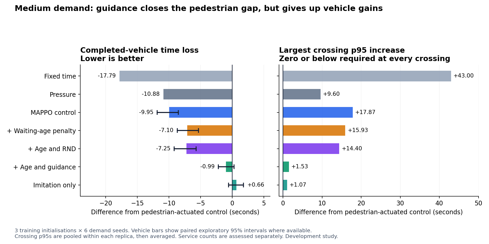
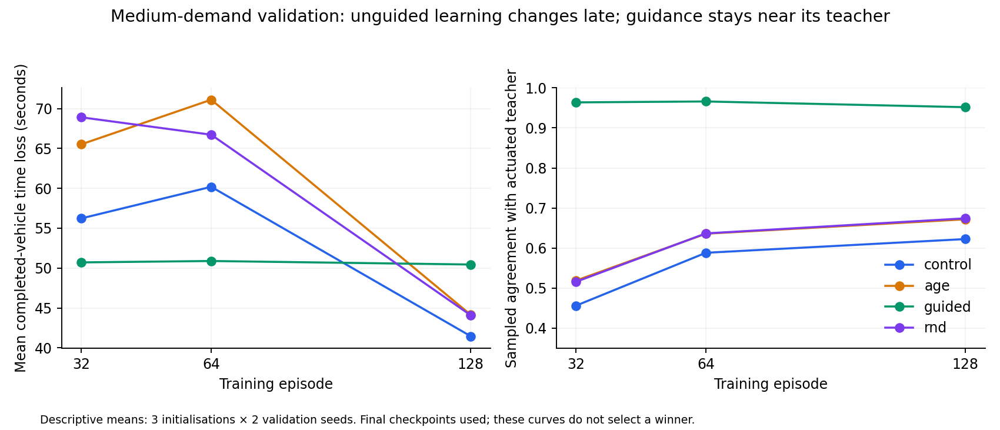

# Guided exploration cluster results — 3 November 2026

The study completed its planned training and evaluation. It demonstrates useful learning and a strong effect of teacher guidance, but none of the four MAPPO variants achieves lower vehicle time loss, no worse pedestrian p95 at every crossing, and no service deterioration against pedestrian-actuated control in any of the four settings. Guidance produces near-teacher pedestrian performance in ordinary demand and slow walking; it also inherits much of the teacher's vehicle-service weakness under congestion. Three congested runs have substantial unresolved pedestrian demand and require targeted replay.

This is a MAPPO development study, not the original IPPO-versus-MAPPO × vehicle-versus-pedestrian reward comparison. Its control already penalises pending pedestrians. Reserved final seeds remain unused.

## What was completed and checked

- Four MAPPO arms × three initialisations × 128 episodes: 12 final trained models and 1,536 training simulations.
- Three imitation-only models, 12 demonstration episodes, 6 teacher validation runs, 72 learned validation runs, 104 baseline runs and 360 development evaluations: 2,090 planned simulations represented by the study's records.
- All 484 manifest file hashes and archived source hashes match. All 15 final model hashes match their recorded identities and evaluations. Training schedules, normaliser counts and paired training/evaluation demand and network identities pass the implemented checks.
- Independently recalculated all reported absolute vehicle aggregates, pooled crossing means/p95s, paired point differences, service gates and vehicle bootstrap intervals. These agree with the archived summary. Crossing bootstrap intervals were inspected in the reporting implementation but were not independently regenerated.
- The ZIP has no scheduler completion log, raw simulator traces or demonstration tensors. Artifact completeness is established; physical safety and simulator-level causes were not independently replayed in this review. The original pipeline's runtime assertions are not a proof of deployed safety.

Evidence: [audit and additional diagnostics](audit.json), [original generated report](archived_REPORT.md), [complete original summary](archived_summary.json), [frozen protocol](archived_protocol.json). The analysis reads the ZIP directly without importing its code or loading its model weights. To reproduce, run `python results/guided-exploration-cluster-review/analyze.py` from the repository root.

## Medium demand: vehicle gains still trade against pedestrian tails

Vehicle loss is mean SUMO time loss among vehicles completed by the measurement cutoff, for the scheduled measurement cohort. Values below average matched runs; each learned controller includes all three training replicas. Crossing p95s pool six demand seeds within each replica before averaging across replicas. The final column counts crossing point estimates no higher than actuated; it does not establish statistical non-inferiority.

| Controller | Vehicle loss (s) | Difference vs actuated (s), exploratory 95% interval | Largest crossing p95 increase (s) | Crossings no worse |
|---|---:|---|---:|---:|
| Actuated | 50.55 | Reference | 0.00 | 12/12 |
| Fixed time | 32.76 | -17.79; interval not computed | +43.00 | 0/12 |
| Pressure-inspired | 39.67 | -10.88; interval not computed | +9.60 | 1/12 |
| MAPPO control | 40.61 | -9.95 [-11.85, -8.52] | +17.87 | 0/12 |
| MAPPO age | 43.45 | -7.10 [-8.69, -5.34] | +15.93 | 0/12 |
| MAPPO guided | 49.57 | -0.99 [-2.19, +0.29] | +1.53 | 3/12 |
| MAPPO RND | 43.30 | -7.25 [-9.17, -5.70] | +14.40 | 0/12 |
| Imitation only | 51.22 | +0.66 [-0.57, +1.77] | +1.07 | 7/12 |

The control's approximately 19.7% lower vehicle time loss versus actuated is a real measured benefit under this definition. It does not satisfy the pedestrian objective: all 12 crossing p95 point estimates increase. Pressure-inspired control also deserves attention: at medium demand its vehicle loss and largest crossing increase are both below those of control, age and RND. That does not prove dominance at each crossing or across all service counts.

Actuated crossing p95s range from 25.6 to 28.4 seconds; guided p95s from 26.8 to 28.27 seconds; control p95s from 37.6 to 43.47 seconds. The largest differences can occur at different crossings, so the differences between these ranges are not the reported worst crossing delta.

No measured-cohort crossing request remains unresolved after followup for any evaluated controller at medium demand. The strict service criterion still fails in many matched pairs because it rejects any worse individual crossing cutoff count or vehicle count. For example, 13 of the control's 18 failed pairs are cutoff-only; 5 of guided's 13 failed pairs are cutoff-only. A failed cutoff check should not be described as permanent starvation.

## What each intervention teaches us

**Age-sensitive reward has an effect, but does not enforce the target.** Against the matched control, age improves medium-demand p95 point estimates at 11/12 crossings, while adding 2.84 seconds vehicle loss (interval +1.20 to +4.65). Under the pedestrian burst it improves all 12 crossing point estimates versus control, at +2.66 seconds vehicle loss. Slow walkers improve at 10/12 crossings, with +1.95 seconds vehicle loss. All 12 crossings still have worse p95s than actuated in these settings. The congested outlier below rules out a robust fairness claim.

**Guidance is the largest behavioural change.** At medium demand, adding guidance to age improves every crossing p95 point estimate, by about 2.13–14.60 seconds depending on the crossing, but adds 6.12 seconds vehicle loss (interval +4.85 to +7.40). The paired bootstrap interval for the worst crossing difference versus age includes zero in medium demand; improvement at all crossings is a descriptive result, not a simultaneous statistical guarantee.

**The teacher can be imitated, and PPO mostly stays near it.** Imitation-only actors agree with the teacher on about 97.2% of sampled free decisions in initial closed-loop validation. On medium evaluation, agreement is about 96.8% for imitation-only and 94.9% after guided training. Thus there is no evidence of wholesale imitation failure in ordinary demand. Guided PPO lowers vehicle loss by 1.65 seconds versus imitation-only (interval -2.63 to -0.53), but worsens p95 point estimates at 8/12 crossings and does not beat actual actuated control reliably. Pretraining and ongoing guidance are bundled, so their separate contributions cannot be identified.

**RND provides no convincing additional vehicle benefit over age.** At medium demand the paired vehicle difference is -0.15 seconds, with interval -2.21 to +1.99. Its intervals include zero in every setting; crossing changes are mixed. RND has no unresolved measured requests in these runs, unlike the single age outlier, but three initialisations do not establish a robust reduction in rare-failure risk. The tested novelty bonus does not solve the vehicle–pedestrian objective.

## Congestion exposes service failures that averages hide

Short spacing also raises demand: it is a combined congestion/geometry stress test. The scheduled measurement cohort averages 2,391.5 vehicles. Counts below are means, with vehicle completion measured at 2,100 seconds and pedestrian followup ending at 2,400 seconds.

| Controller | Vehicle loss (s) | Completed vehicles | Unfinished vehicles | Uninserted vehicles | Unresolved crossing requests |
|---|---:|---:|---:|---:|---:|
| Fixed time | 38.27 | 2,277.83 | 82.67 | 31.00 | 0.00 |
| Actuated | 43.13 | 780.67 | 72.83 | 1,538.00 | 0.00 |
| MAPPO control | 63.99 | 1,701.44 | 92.22 | 597.83 | 0.00 |
| MAPPO age | 61.35 | 1,528.33 | 90.22 | 772.94 | 4.22 |
| MAPPO guided | 47.11 | 805.39 | 65.61 | 1,520.50 | 13.06 |
| MAPPO RND | 64.34 | 1,558.33 | 89.22 | 743.94 | 0.00 |
| Imitation only | 47.86 | 852.17 | 67.72 | 1,471.61 | 0.00 |

Actuated serves about 33% of scheduled vehicles; control about 71%; fixed about 95%. Comparing 43.13 versus 63.99 seconds without these counts would conceal control's much greater throughput. Fixed time still adds up to 43.2 seconds crossing p95 relative to actuated, so it is not a joint solution either.

SUMO records insertion waiting as `departDelay`, separately from driving `timeLoss`. This archive does not contain the new departure-delay aggregates or raw tripinfo needed to reconstruct them. Its vehicle loss cannot be interpreted as total scheduled-demand delay. [Official SUMO TripInfo definitions](https://sumo.dlr.de/docs/Simulation/Output/TripInfo.html)

The learned runs with unresolved measured crossing requests are:

| Model | Demand seed | Unresolved requests | Affected junction | Total pedestrian-clearance time of 2,400 s |
|---|---:|---:|---|---:|
| Age, replica 2 | 890004 | 76 | C2 | 1,953.6 s |
| Guided, replica 1 | 890004 | 105 | C1 | 1,838.0 s |
| Guided, replica 2 | 890005 | 130 | C0 | 2,146.0 s |

These are accumulated phase durations, not verified single continuous stalls. They are consistent with a junction being held in pedestrian clearance for much of the run; the archive alone cannot identify the underlying obstruction, conflict or movement trajectory. A cause must be established with trace replay before attributing this solely to the reward, actor or pedestrian simulation.

The guided mean worst p95 increase of only 1.20 seconds in this setting is particularly easy to misread. It concerns served requests. In replica 2 / seed 890005, two affected crossings have zero observed entries and 52 and 39 unresolved requests; another has just two entries and 39 unresolved requests. Pooling other seeds supplies enough samples for a finite p95, but cannot make those unserved requests disappear. The service gate correctly rejects this result. The age outlier includes per-run crossing p95s of 769–831 seconds.

## Slow walkers and evidence of continued learning

Under slow walking, guided's vehicle difference versus actuated is +0.49 seconds (interval -0.67 to +1.69), with 7/12 crossing p95 point estimates no worse and largest increase +0.40 seconds. Control saves 8.80 seconds vehicle time loss but worsens p95 at every crossing, with a largest increase of 21.53 seconds. Guidance transfers the teacher-like trade-off to slower walkers; it does not establish superiority. The measured crossing cohort is fully served after followup in this setting; full person-trip completion is reported separately in `audit.json`.

Validation provides within-study evidence that the unguided actors continue changing late in training. On the same two medium validation seeds, control vehicle loss is 56.23 / 60.19 / 41.46 seconds at episodes 32 / 64 / 128. Age gives 65.52 / 71.11 / 44.13; RND 68.90 / 66.72 / 44.07. Guided stays near 50.71 / 50.89 / 50.45. These are descriptive trajectories, not a reason to pick a best checkpoint or a promise that more training will improve the joint target.

Each actor receives only 3,969–4,851 actual free decisions over 128 episodes, despite 76,672 recorded training states. Most time steps are forced by signal safety/minimum phase rules. The experiment's total simulation count is much larger than the experience of any individual policy. The better final control outcome compared with the earlier 64-episode repair study is encouraging, but different seeds prevent attributing that cross-study difference solely to longer training.

## Interpretation and next decision

1. Preserve this result as evidence that reward shaping and guidance move the learned trade-off. None has met the joint target; none should be promoted as a winner.
2. Prioritise replay of the three failed congested runs, paired with actuated and imitation-only control. Record crossing occupancy, admission/clearance transitions, person trajectories and collision diagnostics. Maintain the protective clearance rules while diagnosing the cause.
3. Evaluate the already identified observation and training fixes in a separately frozen, matched experiment. This ZIP predates local changes to `fairness/environment.py`, `fairness/demand.py` and `metrics.py`. It does not test controller-memory observations, separate actor/critic clipping, external-backlog information or the newly added insertion-delay measurements. The uploaded source remained internally consistent.
4. Use the current fidelity evidence to distinguish imitation from improvement: the actor can reproduce a useful baseline; the unresolved problem is learning a better, robust policy under the joint objective. Keep imitation-only and pressure-inspired benchmarks in any next study.

The evidence is limited to one synthetic corridor, three initialisations, six evaluation demand seeds and one action stream per demand/junction. Medium and burst settings share most of their traffic. Pooled crossing entry counts exceed the study's 100-entry threshold, but the raw zero-entry failures above remain material. These findings concern the tested simulation and learning budget; they do not show that MARL cannot work or that a dominating policy must exist.
