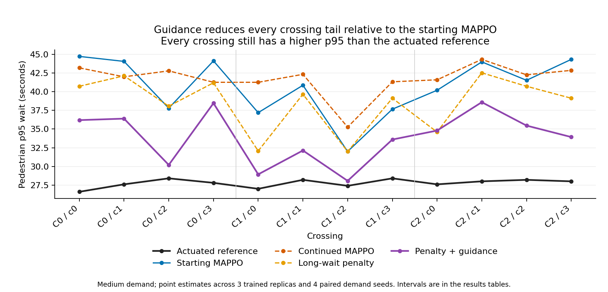
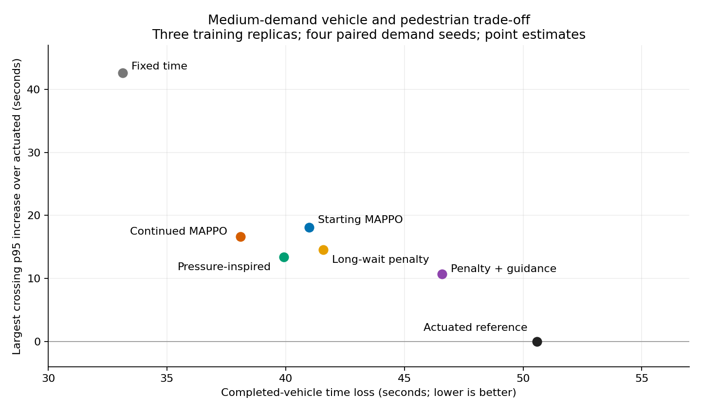

# Pedestrian-focused continuation: completed cluster review

Reviewed 4 November 2026. All 876 planned simulations completed: 576 training,
54 validation, 54 baselines and 192 learned evaluations. Nine models received
64 additional training episodes, starting from all three vehicle-efficient
128-episode MAPPO-control parents. Three frozen parents were evaluated again
on the same new demand. These parents already used pedestrian reward weight 3;
they are not vehicle-only-reward models.

**The intervention changes the trade-off in the intended direction, but does
not meet the original pedestrian target.** Guided fine-tuning improves the
p95 point estimate at every crossing relative to its starting MAPPO in all
four settings. All 12 crossing p95s nevertheless remain higher than actuated
in every setting. Continuing ordinary training produces the greatest vehicle
gain among the learned arms, with worse pedestrian service than actuated.

## Independent verification

The review read the ZIP directly and did not execute its archived source or
deserialize model weights. It checked:

- All 1,174 manifest file hashes, 53 frozen source files, three parent-model
  identities against the earlier archive, and nine final trained-model hashes.
- All 576 training episode identities, equal demand/network schedules across
  arms, 54 validation records, 54 baseline records and 192 evaluation records.
- The 576 stored teacher datasets: hashes, free-action coverage, legal teacher
  and student actions, urgency-label selection, learner counts, selected arm
  coefficients and inherited value-normalizer sample counts.
- All 300 baseline/validation/evaluation event files, 3,600 crossing records,
  vehicle/person accounting and insertion-delay identities. Event timestamps
  reproduce the recorded arrival-to-entry waits and pending counts.
- All 28 controller-by-setting aggregate rows and 88 paired comparison point
  estimates/service components. Vehicle bootstrap intervals were independently
  reproduced for all 56 comparisons with intervals. Crossing intervals were
  inspected in the reporting code but not independently regenerated.
- All 277,395 observed crossing entries occurred under the admission signal
  active during the corresponding completed simulation step. Of these, 1,094
  were observed exactly when the controller subsequently began clearance;
  the code observes movement before applying that timestamp's transition.
  Treating the newly applied state as the previous movement's signal would
  incorrectly label those entries as admission violations.

No unknown/lost measured events, unresolved measured crossing requests or
entered-without-observed-exit events were found in the reviewed outcome records.
This is evidence from the recorded simulator setting, not a fresh physical
replay or a deployed-safety claim. All fine-tuned models completed every person
trip in their evaluation runs. Fixed time left 16 person trips unfinished
across four slow-walker runs; original MAPPO replica 0 left two in one such run.
These are whole-trip outcomes, distinct from measured-cohort crossing requests.

Evidence: [independent audit](audit.json), [original report](archived_REPORT.md),
[full summary](archived_summary.json), [protocol](archived_protocol.json).
Archive SHA256: `255b82536b3a341c8964ef2338b5bd0a5e54fbe73dfd8e89fd9315b18c46354b`.

## Medium demand

Lower vehicle loss and lower crossing differences are better. Counts are means
across matched runs. Vehicles belong to departures scheduled in [300,2100) s,
measured at 2100 s. Pedestrians reaching crossings in that window are followed
to 2400 s. Each learned arm has three training replicas and four demand seeds.

| Controller | Vehicle time loss s | Change vs actuated | Crossings no worse than actuated | Largest crossing p95 increase s |
|---|---:|---:|---:|---:|
| Actuated | 50.59 | Reference | Reference | 0.00 |
| Fixed time | 33.14 | -34.50% | 0/12 | 42.60 |
| Pressure-inspired | 39.93 | -21.08% | 1/12 | 13.40 |
| Original MAPPO | 40.99 | -18.98% | 0/12 | 18.13 |
| Continued MAPPO | 38.10 | -24.70% | 0/12 | 16.60 |
| Long-wait penalty | 41.59 | -17.79% | 0/12 | 14.53 |
| Penalty plus guidance | 46.59 | -7.92% | 0/12 | 10.67 |

The guided vehicle advantage is -4.00 s with an exploratory paired 95% interval
[-5.36, -3.16]. Continued training gives -12.50 s [-13.99, -11.01]. These
intervals support vehicle gains within this development design; they do not
support the missing pedestrian non-inferiority claim.

Guidance reduces the largest crossing excess from 18.13 to 10.67 s relative
to the frozen parent, while retaining part of its vehicle advantage. Actual
guided p95s range from 28.07 to 38.60 s; actuated ranges from 26.60 to 28.40 s.
Compare corresponding crossings rather than subtracting extrema at different
crossings. All guided crossing differences versus actuated are positive,
between +0.67 and +10.67 s. This is not a rounding-tie failure.

## What each controlled comparison establishes

**Extra ordinary training improves vehicle flow.** Relative to the same
frozen parent on the same demand, continued MAPPO reduces medium vehicle
time loss by 2.89 s, interval [-4.90, -0.94]. It also reduces vehicle-loss
point estimates in the other three settings. At medium demand only 4/12
crossing p95 point estimates are no higher than its parent, and none is no
higher than actuated. Learning is occurring; optimizing the existing incentive
does not automatically solve crossing fairness.

**A long-wait cost moves behaviour toward pedestrian service.** Compared
with ordinary continued training, the tail arm improves 11/12 crossing p95
point estimates at medium demand and adds 3.50 s vehicle loss, interval
[2.04, 4.78]. The remaining crossing increases by 0.13 s. The same 11/12
pattern occurs in the other three settings, with different effect sizes.

**Guidance adds a further pedestrian shift.** Compared with tail alone,
guidance improves 11/12 medium crossing p95 point estimates, at +5.00 s
vehicle loss, interval [4.14, 6.12]. The remaining crossing increases by
0.20 s. It improves all 12 point estimates against tail in the other settings.
Against the frozen parent, guidance improves all 12 crossing point estimates
in every setting, while raising medium vehicle loss by 5.60 s [3.87, 7.68].

These crossing counts describe point estimates. For example, the bootstrap
interval of the worst crossing difference against the parent at medium demand
is [-3.93, +8.40] s. It does not establish simultaneous improvement at every
crossing. Few training replicas and demand seeds constrain the conclusion.

In short spacing, the tail arm appears better than the frozen parent on both
completed-vehicle loss (-3.42 s) and all 12 crossing p95 point estimates.
It nevertheless completes fewer vehicles (1,704.50 vs 1,741.25) and leaves more
uninserted (596.67 vs 556.83). Its strict service criterion fails. This tempting
subset must not be presented as a complete joint improvement.

## All four settings

Vehicle time loss in seconds; no fine-tuned arm achieves any no-worse crossing
against actuated in these four aggregate comparisons.

| Setting | Actuated | Frozen parent | Continue | Tail | Guided |
|---|---:|---:|---:|---:|---:|
| Medium | 50.59 | 40.99 | 38.10 | 41.59 | 46.59 |
| Pedestrian burst | 50.59 | 40.92 | 38.30 | 41.74 | 46.62 |
| Short spacing with higher vehicle demand | 39.39 | 65.86 | 61.50 | 62.44 | 66.24 |
| Slow walkers | 53.09 | 43.26 | 41.09 | 44.39 | 49.37 |

Medium and burst share the background schedule; adding a concentrated burst
does not change the reference's vehicle aggregates in these particular seeds.
They are not independent sites. The short-spacing case changes both geometry
and demand, so it cannot isolate a spacing effect.

## Service accounting: keep the congestion result visible

The short-spacing measurement cohort averages 2,391.25 scheduled vehicles.

| Controller | Completed | Unfinished | Uninserted | Vehicle time loss s |
|---|---:|---:|---:|---:|
| Actuated | 729.25 | 67.75 | 1,594.25 | 39.39 |
| Fixed | 2,288.50 | 86.75 | 16.00 | 37.11 |
| Pressure-inspired | 1,923.75 | 86.50 | 381.00 | 52.24 |
| Frozen parent | 1,741.25 | 93.17 | 556.83 | 65.86 |
| Continue | 1,810.50 | 87.50 | 493.25 | 61.50 |
| Tail | 1,704.50 | 90.08 | 596.67 | 62.44 |
| Guided | 1,544.92 | 87.08 | 759.25 | 66.24 |

Continued MAPPO serves about 2.48 times as many measurement-cohort vehicles
as actuated in this stress case; fixed and pressure-inspired serve still more.
Actuated's low completed-trip loss describes its served minority. Guidance
trades some of the parent's vehicle throughput for shorter pedestrian tails,
but still has higher p95 at every crossing than actuated.

At medium demand, the guided arm completes 931.92 vehicles versus 929.00
actuated from 963.75 scheduled, but averages 0.33 rather than 0.25 uninserted
at cutoff. One extra uninserted vehicle occurs in one of the twelve paired
guided runs. Continued and guided each leave one vehicle unfinished at the
whole-run horizon across their twelve medium runs; other medium controllers
complete all whole-horizon vehicles. Preserve these counts rather than calling
an average completion gain an exact no-service-deterioration result.

Many strict service failures are sensitive to cutoff timing. For medium guided,
10/12 matched pairs fail some service component, including five cutoff-only
failures. All measured requests are served during followup. A cutoff-only
failure should not be described as permanent pedestrian starvation.

## Why the intervention changes outcomes but misses the reference

The teacher advises urgent pedestrian service, but does not override the
student. Advice is selected only when pedestrian service is legal and the
oldest pending wait has reached 20 s. The actuated reference can request
pedestrian service earlier. The model still samples actions and balances its
vehicle reward, teacher cost and anchoring to the parent.

The archived training datasets show that selected urgent advice is followed
in 64.34% of opportunities during guided episodes 1-16, rising to 78.94% in
episodes 49-64. Ordinary continuation rises only from 61.89% to 62.72%; tail
alone rises from 62.99% to 69.97%. These are descriptive rates on each policy's
own training states, not matched-state causal estimates or evaluation accuracy.
They verify that guidance changed behaviour, while leaving substantial urgent
advice unfollowed. They do not establish that stronger guidance would dominate
the reference.

At medium evaluation, pedestrian admission plus clearance occupies 46.31% of
junction time for the parent, 45.17% for continuation, 48.45% for tail and
51.45% for guided. Actuated uses 50.15%. Guided uses slightly more total
pedestrian-service time than actuated yet has worse crossing tails. Scheduling
that service promptly, where people are waiting, matters in addition to the
total duration. This is descriptive phase evidence, not proof of a unique
causal bottleneck or a claim that simply extending WALK solves the problem.

## Decision and limitations

Retain this experiment as evidence that the pedestrian incentive and advice
shift an already vehicle-efficient policy toward shorter waits, at a vehicle
cost. It is stronger evidence of this mechanism than an unexplained unsuccessful
run. The original every-crossing objective, and even the suggested 6/12 partial
threshold relative to actuated, remain unmet.

Do not repeat the same training configuration unchanged merely to obtain a
favorable result. The report can now distinguish (1) learning that improves
vehicle performance, (2) learning that improves pedestrian tails relative to a
learned parent, and (3) failure to beat a strong pedestrian-responsive reference
jointly. Any further bounded experiment should test earlier or more reliable
pedestrian service, a specific hypothesis supported by these traces; it must
keep matched conventional baselines, vehicle service counts, fresh evaluation
seeds and the negative outcomes. It is not a promised solution.

This is a supplementary MAPPO study, not a new IPPO-versus-MAPPO ranking.
The three parents were selected as a configuration from earlier development;
all its replicas are included. Final reserved seeds 58001-58020 remain unused.
Synthetic demand, 600-second training resets versus 2400-second evaluation,
three training replicas and four demand seeds limit generalization. Parent
anchoring is a regularizer rather than a performance guarantee.

Two secondary comparisons have floating-point ties: slow-walker continuation
versus the parent counts 4 rather than 3 no-worse crossings with a 1e-9-second
arithmetic tolerance; tail versus parent counts 10 rather than 9. No actuated
comparison or central conclusion changes. The original archive is preserved.
