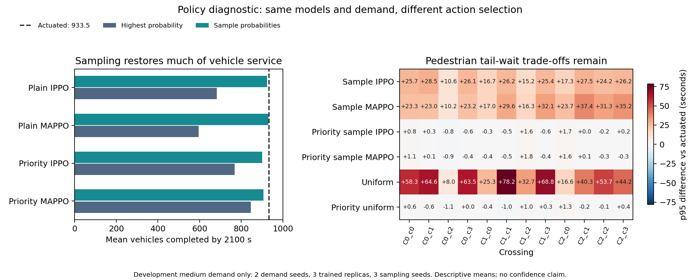

# Service-policy audit review

All 110 evaluations completed. All 26 deterministic replays independently match the previous pilot archive, including full vehicle, person and crossing records. ZIP integrity, manifest coverage, demand pairing, vehicle/person counts, crossing means, quantiles and interval ordering passed checks. SUMO version: 1.27.1. No final test seeds were used.

## Findings

The evaluation-mode hypothesis is supported on these saved checkpoints: probability sampling removes most of the severe vehicle under-service seen with argmax. It does not meet the joint proposal target. Plain sampled policies have worse p95 point estimates at all 12 crossings. Priority sampling protects more crossing tails but incurs substantially higher vehicle time loss. No arm passes the combined target.

Uniform choices also restore vehicle insertion. Plain learned sampling has worse mean vehicle loss than uniform, but substantially smaller worst-crossing penalties: learning cannot be judged solely from vehicle flow. Priority sampled MAPPO has somewhat better descriptive vehicle results than priority uniform; neither beats actuated on the joint objective. These are observations on two development demand seeds, not statistical superiority claims.

## Complete medium-demand comparison

Vehicle counts cover trips scheduled in [300,2100) and their status at 2100 seconds. There are 974.5 scheduled vehicles on average. Unfinished vehicles at that cutoff are distinct from unserved pedestrians after the 2400-second follow-up. Vehicle time loss is conditional on completion.

| Controller | Choice | Runs | Vehicle loss s | Completed | Unfinished | Uninserted | Crossing p95 no worse / 12 | Worst p95 delta s | Service-flagged runs |
|---|---|---:|---:|---:|---:|---:|---:|---:|---:|
| actuated | baseline | 2 | 51.64 | 933.5 | 41.0 | 0.0 | 12/12 | +0.00 | 0/2 |
| plain-ippo | argmax | 6 | 34.98 | 682.2 | 51.8 | 240.5 | 5/12 | +1.40 | 6/6 |
| plain-ippo | sample | 18 | 54.94 | 923.4 | 50.6 | 0.6 | 0/12 | +28.49 | 18/18 |
| plain-mappo | argmax | 6 | 32.62 | 596.3 | 77.3 | 300.8 | 4/12 | +1.40 | 6/6 |
| plain-mappo | sample | 18 | 54.48 | 929.9 | 44.6 | 0.0 | 0/12 | +37.40 | 15/18 |
| priority-ippo | argmax | 6 | 57.86 | 767.8 | 62.7 | 144.0 | 6/12 | +1.33 | 5/6 |
| priority-ippo | sample | 18 | 102.21 | 901.0 | 66.9 | 6.6 | 7/12 | +1.67 | 18/18 |
| priority-mappo | argmax | 6 | 64.75 | 845.7 | 65.2 | 63.7 | 8/12 | +1.20 | 6/6 |
| priority-mappo | sample | 18 | 95.25 | 907.3 | 65.2 | 2.0 | 7/12 | +1.76 | 18/18 |
| uniform-plain | uniform | 6 | 46.72 | 935.5 | 39.0 | 0.0 | 0/12 | +78.20 | 6/6 |
| uniform-priority | uniform | 6 | 101.11 | 894.7 | 71.5 | 8.3 | 7/12 | +1.27 | 6/6 |

Crossing estimator: pool the two demand seeds within each model and policy-random seed, compute each crossing p95, then average those p95s across trained models and policy seeds. The reference pools the two actuated runs once. Policy-seed repeats are not extra independently trained models. Only 1e-9 s floating-point roundoff is ignored. No sparse or missing wait is converted to zero.

All 110 runs completed all scheduled person trips by simulation end and had zero unresolved measured crossing requests, zero unknown entries and zero lost events. Service flags here are vehicle or crossing-cutoff comparisons; they must not be presented as permanent pedestrian starvation. The full per-crossing means, tails, entry counts and signed service components are in summary.json.

## Mechanism evidence

For plain-mappo-r0, demand seed 47001, C0 EW has 2354 consecutive queued/no-green samples under argmax. Under sampling the corresponding maxima are 153, 144 and 200 seconds. This is a movement-level diagnostic, not an individual vehicle wait. The mean gap between the top two action probabilities in the argmax replay is only 0.00823. The comparison changes action selection while retaining the checkpoint, physical rules and scheduled demand.

## Critic evidence

| Sampled controller | Mean value prediction | Mean discounted observed return | Median explained variance |
|---|---:|---:|---:|
| plain-ippo | -4.58 | -132.64 | 0.0033 |
| plain-mappo | -3.48 | -135.69 | 0.0020 |
| priority-ippo | -3.49 | -185.24 | 0.0032 |
| priority-mappo | -6.84 | -168.31 | 0.0027 |

Values and returns are reward units, not seconds. Near-zero explained variance and large mean-scale differences indicate poor calibration on these trajectories. Realised Monte Carlo targets contain randomness, the evaluation horizon is longer than training, and selected checkpoints span episodes 8-32. This does not prove a specific optimiser bug or establish convergence. In particular, action-mode changes do not repair the learned value estimator.

The current learner scales the squared value error by the return standard deviation while leaving its value output in raw reward units. That is different from training a normalised value output and denormalising it before computing advantages. The [official MAPPO implementation](https://github.com/marlbenchmark/on-policy/blob/main/onpolicy/algorithms/r_mappo/r_mappo.py) supports value normalisation and uses separate actor and critic optimisers. Those are concrete implementation choices to test, not guarantees of better traffic outcomes.

## Recommended next work

1. Preserve the original study and both diagnostics. Report the demonstrated argmax failure and the vehicle-pedestrian trade-off. Do not silently replace the original final-test evaluation mode.
2. Before another long training job, check whether the value estimator can fit known return targets on a small, separately held-out set of development trajectories. Compare the current critic with a correctly normalised critic at matched update budgets. Log raw-value bias/RMSE and explained variance; test save/resume and raw/normalised unit consistency.
3. If that check succeeds, run a controlled IPPO/MAPPO critic-normalisation ablation using the same demand, actor, reward, safety and training budget. Freeze the sampling evaluation protocol in advance; report argmax as a sensitivity test. Use ordinary and priority uniform controls and the conventional baselines. Do not combine reward, green-duration, layout and training changes into an unexplained single intervention.
4. A separate controller-design hypothesis is actuated-guided or residual learning: retain demand-responsive service and let learning make bounded allocation adjustments. Compare it against the same conventional rule without learning. If adding movement service protection, enforce it consistently and verify minimum greens, clearance and blockage behaviour. Neither a warm start nor a service rule guarantees every-crossing p95 non-inferiority.
5. Use the reserved final test seeds only after a development candidate and its evaluation protocol are frozen. A final claim requires repeated independent training, sufficient crossing samples and uncertainty. Current evidence concerns one synthetic medium-demand setting and cannot establish deployed benefits.

## Scope of this review

This review analysed the downloaded results and generated the figure below. It did not retrain controllers, alter simulator safety rules or launch a new cluster job. The result archive contains no model weights or full state/reward trajectories, so it cannot by itself run the proposed critic-fitting check.

